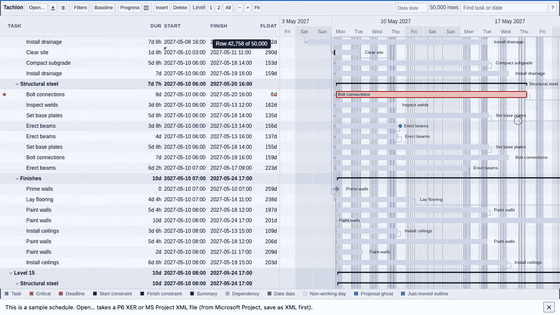

#  Tachlon: Blazingly Fast Gantt Scheduling Component

**A fully featured Gantt and scheduling component for your product, built in Rust and WebAssembly and drawn by the GPU: customizable, easy to integrate, free and open source, and AI first.**

[Website](https://tachlon.com) · [Live demo](https://app.tachlon.com) · [Guide](https://app.tachlon.com/book/) · [npm](https://www.npmjs.com/package/tachlon)

[](https://www.npmjs.com/package/tachlon) [](LICENSE)

<!-- screencast:begin (written by demos/screencast/run.sh; do not edit by hand) -->

<a href="https://tachlon.com"></a>

Watch the narrated overview at [tachlon.com](https://tachlon.com).

<!-- screencast: the GIF stands in until docs/media/screencast.mp4 (4.9 MB) is uploaded as a GitHub attachment; its URL on a line of its own then replaces the image -->
<!-- screencast: recorded headless on a MacBook Pro (Apple M3 Pro, WebGPU) on 2026-11-17 from branch `agent/screencast-rerecord` based on `2908360` -->
<!-- screencast:end -->

Needs a browser with WebGPU or WebGL2 and hardware acceleration on: a current Chrome, Edge, Firefox or Safari. Measured in Chrome.

## Why Tachlon

- **Blazingly fast.** The engine is Rust compiled to WebAssembly, and the GPU draws the timeline. After a drag, 50,000 tasks reschedule in under 20 milliseconds (17.8 ms on a Mac mini with an Apple M4 chip, in Chrome 156). [Measured](#measured)
- **AI first.** Built for developers who work with an AI assistant. Your assistant installs it from one prompt, reads the guide that ships inside the package, asks the package what it can do, and checks its own work. [For your assistant](#for-your-assistant)
- **Free and open source.** MIT. Every feature, with no paid tier, license key, trial or watermark.
- **Powerful.** Auto-scheduling, critical path, constraints, calendars, baselines and progress, with Primavera P6 and MS Project files opened and saved in the browser. [What it does](#what-it-does)
- **Yours.** It fits inside your page, takes your theme, keeps your ids and hands every edit to your code. [Make it yours](#make-it-yours)

## Add it

Paste this prompt into your AI assistant:

```text
Add a Tachlon Gantt chart to this app. Install the npm package tachlon and follow the
AGENTS.md inside it (more at tachlon.com/llms.txt). Put the chart on one existing page
and change nothing else. Run the build and npx tachlon doctor until both pass. Commit on
a new branch; do not push.
```

Your assistant reads the `AGENTS.md` inside the package, installs on a new branch, puts the chart on one existing page, and runs your build and `npx tachlon doctor` until both pass. It commits its work and does not push.

Prefer to do it yourself? See [Install by hand](#install-by-hand).

## What it does

- **Scheduling.** Four link types with lag and lead, dates recomputed from the links on every edit, critical path, eight constraint types, working calendars with holidays and a calendar per task, baselines with variance, progress against a data date, summary tasks and milestones.
- **Answers.** Schedule-quality checks, what-if, "why does this task start here", and a comparison with an earlier file.
- **Editing.** A task dialog, inline cells, drag to move, resize and link, grouping, and undo and redo.
- **Files.** Opens and saves Primavera P6 XER and MS Project XML inside the browser, with no server or conversion service for you to run. The [live demo](https://app.tachlon.com) reads your file in the browser and sends it nowhere. On the hosted app, press Open… in the toolbar and choose your .xer or .xml. To check for yourself that the file goes nowhere, open the browser's developer tools and watch the Network tab while you open it: no upload appears. A test, [hosted-no-upload.test.ts](packages/gantt/tests-node/hosted-no-upload.test.ts), fails if the hosted app's own source adds an upload (run `node --test tests-node/hosted-no-upload.test.ts` in `packages/gantt`). [What an open keeps and drops](docs/IMPORT.md#what-an-open-keeps-and-drops) lists each item: P6 baselines and resources are not read, an MS Project open shows resource names only, and saving as XER does not go back into P6 intact, because it leaves out activity codes, baselines, deadlines and the tables the open skipped. Exports Excel, PDF and PNG, and prints with a header, page numbers and a legend.
- **Display.** 50,000 tasks open and scroll. Zoom from years to hours, light and dark themes, a color per bar, keyboard navigation, screen-reader access to the bars, translated text and right-to-left layout.

Every feature is a row in [Compared](#compared).

## Make it yours

- **Your page.** The chart fills the box your page gives it, follows that box when it resizes, and keeps its styles to itself.
- **Your look.** Colors, bar shape, row height and type are CSS tokens, in light and dark, that your own CSS sets.
- **Your data.** `mount` takes plain `tasks` and `links`. `chart.snapshot()` gives them back, and `chart.toDocument()` returns a lossless document that `chart.load({ document })` reads.
- **Your ids.** A task or a link takes a `key`, your own id. It stays with the record through every edit and save, and the `select`, `move` and `edit` events give it back.
- **Your backend.** The `edit` event carries each undo step as a numbered commit, with each change as one record with `set` and `was`, ready to save.
- **Your rules.** One option makes the chart read-only, and it can be switched while the page runs.
- **Your stack.** Plain JavaScript, and React, Vue and Angular components in the same package. The same engine runs in Node with no page (`tachlon/headless`).

`npx tachlon describe` lists every option, event, command, method, CSS token and refusal reason of the version you installed. The guide to the API is [packages/gantt/README.md](packages/gantt/README.md).

## For your assistant

Tachlon is built for a developer who works with an AI assistant, and it was built that way: one person owns the product and decides what it is, and a team of AI agents wrote, tested and reviewed the code ([docs/HOW-THIS-WAS-BUILT.md](docs/HOW-THIS-WAS-BUILT.md)).

The package carries its own instructions, so your assistant works from the version it installed, not from a web page that may describe another one.

| | What it does |
|---|---|
| The prompt | One prompt installs the chart, puts it on a page and checks the result. |
| [`AGENTS.md`](packages/gantt/AGENTS.md) | The guide inside the package: the steps in order, and what never to do. |
| `npx tachlon describe` | The package describes itself: every option, event, command, method, CSS token, error and refusal reason of the installed version, generated from the types, as text or JSON. `describe fit` is the procedure for fitting the chart to your product, visually and technically. |
| [`npx tachlon doctor`](packages/gantt/README.md#check-an-install-with-tachlon-doctor) | Checks an install, writes nothing, and prints a fix under each failed check. |
| [`validate`](packages/gantt/README.md#start-errors) | Checks your task data and names each problem by path, with a fix. |
| [`init --skill`](packages/gantt/README.md#add-it-to-a-vite-app) | Writes a skill file that tells your assistant when to use the package, where its `AGENTS.md` is, and what never to do. |
| [`llms.txt`](https://tachlon.com/llms.txt) | Tells an assistant what to read first. |
| [Engine tools](packages/gantt/README.md#tools-for-an-ai-assistant) | Typed tools, in MCP, Anthropic and OpenAI forms, for the assistant inside your own product: five ask the engine about the schedule, and one proposes an edit for a person to accept. |
| [In-chart assistant](packages/gantt/README.md#tools-for-an-ai-assistant) | Give `mount` an `assistant` option and the chart puts a chat box beside itself. Your own `send` calls your model. |
| Your product's user guide | Coming: product-neutral user chapters in the package, with a prompt your assistant uses to turn them into your own product's documentation. Today [`packages/gantt/guide/`](packages/gantt/guide/README.md) holds the guide's frame and its first chapter, the task dialog; the chapters and the prompt arrive with a coming release. |

## Measured

After a drag at 50,000 tasks, the engine reschedules in 17.8 ms, and 50,000 tasks load in 291.7 ms. The engine is Rust compiled to WebAssembly, the GPU draws only the rows on screen, and the engine and the renderer share one block of memory, so a drag recomputes the schedule and redraws it without copying it.

These figures are measured on generated schedules. The repository holds no private schedule: every fixture is a public sample file or a generated one.

To time how long your own file takes to open, open it in the hosted app, click the chart and press `s` ([open time](docs/MEASURING.md#open-time-gs87-pr-5)).

<details>
<summary>The measurements, next to three other charts</summary>

Each cell reads "Tachlon / the other chart" in milliseconds (the last row in MB): the median of 4 matched pairs of runs on a Mac mini (Apple M4) in Chrome 156, on 2026-11-13.

| `tree4` | Bryntum 8 Community | DHTMLX community | SVAR |
|---|---|---|---|
| Load, 10,000 tasks (data to ready) | 117.3 / 160.8 | 118.3 / 71.6 | 111.2 / 69.8 |
| Load, 50,000 tasks (data to ready) | 291.7 / 648.1 | 297.4 / 301.9 | 300.4 / 222.3 |
| Drag frame, 50,000 tasks (p95) | 18.7 / 17.2 | 18.6 / 18.7 | 18.7 / 16.8 |
| Drag commit, 50,000 tasks | 17.8 / 263.7 | 18.1 / 63.8 | 17.9 / 15.9 |
| Memory, 50,000 tasks (MB) | 420.1 / 445.3 | 422.1 / 378.7 | 419.2 / 393.0 |

- A drag frame is the interval between two frames while the first leaf in view is dragged, and p95 means 95 of 100 of those intervals were this short or shorter ([Driving any Gantt the same way](docs/MEASURING.md#driving-any-gantt-the-same-way-gs1199)).
- A drag commit is the time from the release to the chart's commit, once what follows the dragged task is rescheduled: ours when the schedule's revision changes ([the drag commit](docs/MEASURING.md#bryntum-8-community-against-ours-and-the-drag-commit-gantt1949)).
- For a chart that does not reschedule, DHTMLX and SVAR here, the commit is the write of the dragged task's start to its store ([the drag commit](docs/MEASURING.md#bryntum-8-community-against-ours-and-the-drag-commit-gantt1949)).

<sub>DHTMLX and SVAR load 10,000 tasks sooner, SVAR loads 50,000 tasks sooner, and both use less memory. The method, the machine and how to rerun it: [docs/research/2026-11-13-gantt-comparison.md](docs/research/2026-11-13-gantt-comparison.md) and [docs/MEASURING.md](docs/MEASURING.md).</sub>

</details>

## Compared

Feature by feature, with the source for every cell.

<details>
<summary>48 features, next to Bryntum Gantt, DHTMLX Gantt and Syncfusion Gantt</summary>

Tachlon next to Bryntum Gantt, DHTMLX Gantt and Syncfusion Gantt on scheduling, editing, files, display, the developer API, AI integration and licensing, from each vendor's own docs and pricing pages, read on 2026-11-12 and 2026-11-15. A Tachlon cell is `Yes` only when the npm package `tachlon`, as built from this repository, reaches the feature. ★ marks a feature no other vendor's docs show in the same form.

<!-- features-matrix:begin (copied from docs/features.md by scripts/features-matrix.ts --write) -->
| # | Feature | Tachlon | Bryntum Gantt | DHTMLX Gantt | Syncfusion Gantt |
|---|---|---|---|---|---|
| | **Scheduling** | | | | |
| 1 | Four link types (FS, SS, FF, SF) with lag or lead | Yes | All | Both | Yes |
| 2 | Auto-scheduling: dates recomputed from links on every edit | Yes | All | PRO only | Yes |
| 3 | Critical path | Yes | Ent only | PRO only | Yes |
| 4 | Eight constraint types (ASAP, ALAP, SNET, SNLT, FNET, FNLT, must start on, must finish on) | Yes | Core, Ent | PRO only | Yes |
| 5 | Working calendars with holidays, and a calendar per task | Yes | Project calendar: All; task calendars: Core, Ent | Whole-chart working time: Both; project, resource and task calendars: PRO only | Project working time only |
| 6 | Baseline with variance | Yes | Ent only | PRO only | Yes |
| 7 | Progress: percent complete, actual start and finish | Yes | All | Both | Yes |
| 8 | Summary tasks in an outline | Yes | All | Both | Yes |
| 9 | Milestones | Yes | All | Both | Yes |
| 10 | Split tasks | No | Ent only | PRO only | Yes |
| 11 | Resource names on tasks, and a filter by resource | Yes | Core, Ent | PRO only | Yes |
| 12 | Edit resource assignments | No | Core, Ent | PRO only | Yes |
| 13 | Resource workload or histogram view | No | Widget in the examples; not in the feature table | PRO only | Over-allocation mark; no histogram found |
| 14 | Schedule-quality checks (DCMA-style counts) | Yes ★ | Not found | Not found | Not found |
| 15 | What-if and "why does this task start here" | Yes ★ | Not found | Not found | Not found |
| 16 | Compare a schedule with an earlier file | Yes ★ | Not found | Not found | Not found |
| | **Editing** | | | | |
| 17 | Task editor dialog | Yes | Basic: All; full: Core, Ent | Both | Yes |
| 18 | Inline cell editing in the task list | Yes | All | Both | Yes |
| 19 | Drag a bar to move it, and drag to draw a link | Yes | All | Both | Yes |
| 20 | Drag a bar's edge to change its duration | Yes | All | Both | Yes |
| 21 | Undo and redo | Yes | Core, Ent | PRO only | Yes |
| 22 | Group tasks (for example by resource) | Yes; by activity code | Core, Ent | PRO only | Yes |
| | **Files** | | | | |
| 23 | Open MS Project XML | Yes ★ | Ent only | Both, through its export service or a module you host | Yes, through a remote service |
| 24 | Open Primavera P6 XER | Yes ★ | One example; not in the feature table | Yes (XER or XML), through its service or module; edition not stated | Not found |
| 25 | Save as MS Project XML | Yes ★ | Ent only | Both, through its service or module | Through a server |
| 26 | Save as Primavera P6 XER | Yes ★ | Not found | P6 XML only, through its service or module | Not found |
| 27 | Export to Excel | Yes | Ent only | Both, through its service or module | Yes |
| 28 | Export to PDF | Yes, through the browser's print dialog | Ent only; needs a server-side service | Both, through its service or module | Yes |
| 29 | Export a picture (PNG) | Yes | Ent only; needs a server-side service | Both, through its service or module | No (open feature request) |
| 30 | Print with page header, page number and legend | Yes | Ent only | No print method found | No print method found |
| 31 | Read another vendor's Gantt data | Yes ★ | Not found | Not found | Not found |
| | **Display** | | | | |
| 32 | 50,000 tasks open and scroll (virtual rendering) | Yes | No figure stated | Smart rendering: Both; dynamic loading: PRO only | Yes (vendor benchmark at 50,000) |
| 33 | Zoom from years to hours, and fit the project | Yes | All | Both | Yes |
| 34 | Light and dark themes, colors set from CSS | Yes | All | Both | Yes |
| 35 | A color per task bar | Yes | All | Yes; edition not stated | Yes |
| 36 | Custom bar content from a template | No | All | Yes; edition not stated | Yes |
| 37 | Keyboard navigation | Yes | Yes | Both | Yes |
| 38 | Screen-reader access to the timeline bars | Yes | WCAG 2.1 and Section 508 stated as a goal | WAI-ARIA on by default; bars not stated | WCAG 2.2 AA "for most criteria" |
| | **Languages** | | | | |
| 39 | Translated UI text and locale number and date formats | Yes | All (45 locales) | Both (50+ locales) | Yes |
| 40 | Right-to-left layout | Yes; the timeline stays left to right | Not documented | Both | Yes |
| | **Developer API** | | | | |
| 41 | TypeScript declarations | Yes | Yes | Yes | Yes |
| 42 | React, Vue and Angular components | Yes | All | Both | Yes (also Blazor) |
| 43 | Schedule engine in Node with no page | Yes ★ | Not found | A separate "Planning Engine", by quote | Not found |
| | **AI** | | | | |
| 44 | Typed engine tools for an AI assistant (MCP, Anthropic, OpenAI forms) | Yes ★ | Not found (its AI feature is an in-chart agent) | A guide to writing tool calls yourself | Not found |
| 45 | In-chart chat assistant | Yes; you supply the model call | Ent only | No (guide only) | Not found |
| 46 | Docs for coding assistants (llms.txt, AGENTS.md or skills) | Yes | Yes | Yes | Yes |
| | **Licensing** | | | | |
| 47 | Free open-source license | Yes: MIT | Community: MIT, commercial use allowed | Community: MIT (version 10 on; GPL v2 for 9.x and earlier) | No: a free Community License, not open source |
| 48 | Every feature with no paid tier, key or trial | Yes ★ | No: Core $699, Enterprise $1,100 per developer per year; OEM by quote | No: PRO $799 to $5,999, perpetual | No: $959 per developer per year; free only under $1M revenue, 5 or fewer developers and 10 or fewer employees |
<!-- features-matrix:end -->

<sub>Bryntum's tiers are Community (free, MIT), Core and Enterprise ("All" means all three); DHTMLX has Community (free, MIT) and PRO ("Both" means both); Syncfusion has one edition. "Not found" means the vendor pages show no such feature, not that the vendor lacks it. The sources and the evidence for each cell are in [docs/features.md](docs/features.md), the file this table is copied from.</sub>

</details>

<details>
<summary>What it does not do yet</summary>

- Split tasks, editing resource assignments, a resource workload view and custom bar templates (rows 10, 12, 13 and 36 above).
- Native `.mpp` files: save as MS Project XML. P6 baselines are not read yet, and XER files have been tried on P6 version 19.12 only ([docs/IMPORT.md](docs/IMPORT.md)).
- Speed is measured on Apple machines and one Dell laptop so far; Windows, tablets and phones are not measured yet.
- The [open issues](https://github.com/innerstacklabs/tachlon/issues) list the work.

</details>

## Install by hand

```sh
npm install tachlon
```

This is [examples/plain](examples/plain), shortened (its `index.html` holds the box: `<div id="chart" class="gantt" style="width: 800px; height: 300px"></div>`). [examples/react](examples/react) does the same with the React component.

```js
import { mount } from "tachlon";
import "tachlon/gantt.css";

const tasks = [
  { id: 1, name: "Design", start: "2026-11-02", duration: 3 },
  { id: 2, name: "Build", start: "2026-11-05", duration: 5 },
  { id: 3, name: "Ship", start: "2026-11-12", duration: 1 },
];
const links = [{ from: 1, to: 2 }, { from: 2, to: 3 }];

// forceWebgl: this page needs no GPU. Drop it to let the chart use WebGPU when the browser has it.
const chart = await mount(document.getElementById("chart"), { tasks, links, forceWebgl: true });
```

With Vite, add `optimizeDeps: { exclude: ["tachlon"] }` to `vite.config.ts` ([examples/plain/vite.config.ts](examples/plain/vite.config.ts)): Vite otherwise bundles the chart's script away from its engine file, `app_bg.wasm`.

## Documentation

- [The guide](https://app.tachlon.com/book/): one chapter per journey, with the steps by hand.
- [packages/gantt/README.md](packages/gantt/README.md) and [docs/WASM_API.md](docs/WASM_API.md): the API.
- [docs/IMPORT.md](docs/IMPORT.md): what the P6 XER and MS Project XML readers map and leave out.
- [docs/KEYS.md](docs/KEYS.md): every key. [docs/JOURNEYS.md](docs/JOURNEYS.md): what works today, by journey.
- [apps/hosted/README.md](apps/hosted/README.md): the hosted app and its sample schedules.
- [docs/ARCHITECTURE.md](docs/ARCHITECTURE.md) and [docs/decisions/](docs/decisions/): how it is built and why.
- [docs/MEASURING.md](docs/MEASURING.md) and [docs/duration-measurement.md](docs/duration-measurement.md): the tests, the benches and the measured results.

## Contributing

Open a pull request: the code is MIT, and there is no contributor agreement to sign. Contributions made with an AI assistant are welcome: [CLAUDE.md](CLAUDE.md) tells an assistant how the project works, and [REVIEW.md](REVIEW.md) holds the review rules. [docs/CONTRIBUTING.md](docs/CONTRIBUTING.md) has the gates ("Gates"), [docs/DEMOS.md](docs/DEMOS.md) has how to build and run the chart from source, and a `No` row in [Compared](#compared) is a gap you can work on.

## License

MIT, with no paid tier, license key, trial or watermark: [LICENSE](LICENSE) and [decision 0014](docs/decisions/0014-mit-no-paid-tier.md).
