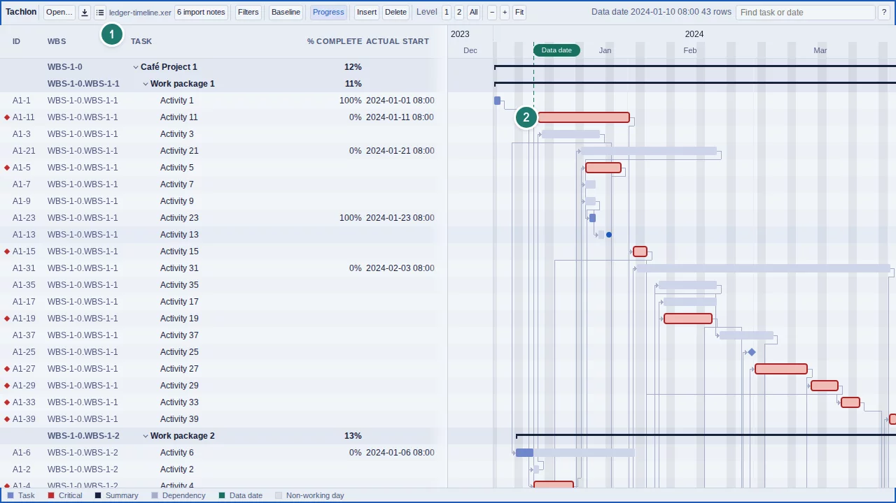

#  Tachlon

Tachlon is a Gantt and scheduling component that you put in your own product, in the same category as Bryntum Gantt, DHTMLX Gantt and Syncfusion Gantt.

- **Fully featured.** Auto-scheduling, critical path, calendars, baselines, undo and redo, file import and export, and React, Vue and Angular components. The [feature table](#how-it-compares) sets each feature beside those three charts, including the rows where Tachlon says `No`.
- **Blazingly fast.** The engine is Rust compiled to WebAssembly, and the GPU draws the timeline. After a drag at 50,000 tasks, Tachlon reschedules in 17.8 ms, against 263.7 ms for Bryntum Gantt 8 Community. It does not lead in every row of the [speed table](#how-fast-it-is).
- **Open source with no strings.** MIT, with no paid tier, license key, trial or watermark ([LICENSE](LICENSE)).

## Try it

Open the [hosted app](https://app.tachlon.com) and pick a schedule from **Open a sample**, or press **Open…** to open a file of your own. You install nothing and sign in nowhere, and the page reads your file in the browser and sends it nowhere.

<!-- screencast:begin (written by demos/screencast/run.sh; do not edit by hand) -->

https://github.com/user-attachments/assets/a2acd61a-7efb-4338-8279-a2ebc7f48633

<!-- screencast: recorded headless on a MacBook Pro (Apple M3 Pro, WebGPU) on 2026-10-29 from branch `docs/screencast-2026-10-29` based on `eca49fe` -->
<!-- screencast:end -->



A made-up P6 test file opened in the app: a still recorded on `main` at `102ab16e` on 2026-11-07.

**[Read the guide](https://app.tachlon.com/book/)**: the book, hosted. CI deploys it from `main`. Once CI runs on pull requests (#455), it also posts a preview link on each ready PR.

The rest of this section is for developers who build from source. You need Rust with the `wasm32-unknown-unknown` target, `wasm-bindgen-cli` 0.2.129 (`cargo install wasm-bindgen-cli --version 0.2.129 --locked`) and pnpm.

```sh
demos/50k/run.sh                          # builds and serves http://127.0.0.1:4173/
demos/50k/run.sh --schedule <file.xer>    # starts with your own P6 XER or MS Project XML file
```

The page opens a generated 50,000-task schedule. Press "Open…" in the toolbar, or drop a file on the chart, to open one of yours. The other options are in [docs/DEMOS.md](docs/DEMOS.md).

## Install

```sh
npm install tachlon
```

## Put a chart on a page

This is [examples/plain](examples/plain), shortened (its `index.html` holds the box: `<div id="chart" class="gantt" style="width: 800px; height: 300px"></div>`). [examples/react](examples/react) does the same with the React component.

```js
import { mount } from "tachlon";
import "tachlon/gantt.css";

const tasks = [
  { id: 1, name: "Design", start: "2026-11-02", duration: 3 },
  { id: 2, name: "Build", start: "2026-11-05", duration: 5 },
  { id: 3, name: "Ship", start: "2026-11-12", duration: 1 },
];
const links = [{ from: 1, to: 2 }, { from: 2, to: 3 }];

// forceWebgl: this page needs no GPU. Drop it to let the chart use WebGPU when the browser has it.
const chart = await mount(document.getElementById("chart"), { tasks, links, forceWebgl: true });
```

With Vite, add `optimizeDeps: { exclude: ["tachlon"] }` to `vite.config.ts` ([examples/plain/vite.config.ts](examples/plain/vite.config.ts)): Vite otherwise bundles the chart's script away from its engine file, `app_bg.wasm`.

## What your code can do

- **Plain data in and out.** `mount` takes plain `tasks` and `links`, and `validate` names each problem in them by path with a fix. `chart.snapshot()` returns the open schedule as plain data. `chart.toDocument()` returns a lossless document that `chart.load({ document })` reads back.
- **Your own ids.** A task or a link takes a `key`, your own id as text. The key stays with the record through edits and saves, and the `select` and `move` events give it back. `chart.commands.assignKey` gives a key to a row or a link that a person made in the chart. A calendar in a schedule document keeps its key too.
- **A record of every edit.** The `edit` event carries each undo step as a numbered commit: where the step came from (`typed`, `drag`, `dialog`, `paste`, `proposal`, `undo` or `redo`) and each change with its old and new values.
- **The engine in Node, with no page.** `openHeadless` from `tachlon/headless` reads an XER file, an MS Project XML file, plain data or a document. `results()` lists every task's early and late dates, total and free float and critical flag, each with its `key`.
- **React, Vue and Angular components.** `tachlon/react`, `tachlon/vue` and `tachlon/angular` come in the same package and take the options of `mount`.
- **Your box, and light and dark themes from CSS tokens.** The chart fills whatever box a page gives it, follows that box when it resizes, and keeps its styles to itself ([docs/ARCHITECTURE.md](docs/ARCHITECTURE.md), "Embedding"). Its colors, bar shape, row height and type are CSS tokens, in light and dark, that your own CSS can set.
- **The whole API.** The options, events and methods are in [packages/gantt/README.md](packages/gantt/README.md) and [docs/WASM_API.md](docs/WASM_API.md).

## How fast it is

Tachlon is blazingly fast at rescheduling. After a drag at 50,000 tasks it reschedules in 17.8 ms, against 263.7 ms for Bryntum Gantt 8 Community, the one other chart in the table that reschedules. It also loads 50,000 tasks sooner than Bryntum (291.7 ms against 648.1 ms). It does not lead everywhere. DHTMLX and SVAR load 10,000 tasks sooner (118.3 ms against 71.6 ms, and 111.2 ms against 69.8 ms), SVAR loads 50,000 tasks sooner (300.4 ms against 222.3 ms), and both use less memory (422.1 MB against 378.7 MB, and 419.2 MB against 393.0 MB).

Measured on 2026-11-13 on a Mac mini (Apple M4), headed Chrome 156 at 60 Hz, with the same generated schedule (`tree4`, seed 20261020) given to each chart. Each cell reads "Tachlon / the other chart" in milliseconds (the last row in MB), the median of 4 matched pairs of runs. The other charts are the free ones from npm: Bryntum Gantt 8 Community, DHTMLX Gantt 10 community and SVAR React Gantt 2.8. Tachlon is faster in some rows and slower in others. DHTMLX and SVAR do not reschedule after a drag, so their commit time is a write to their store.

| `tree4` | Bryntum 8 Community | DHTMLX community | SVAR |
|---|---|---|---|
| Load, 10,000 tasks (data to ready) | 117.3 / 160.8 | 118.3 / 71.6 | 111.2 / 69.8 |
| Load, 50,000 tasks (data to ready) | 291.7 / 648.1 | 297.4 / 301.9 | 300.4 / 222.3 |
| Drag frame, 50,000 tasks (p95) | 18.7 / 17.2 | 18.6 / 18.7 | 18.7 / 16.8 |
| Drag commit, 50,000 tasks | 17.8 / 263.7 | 18.1 / 63.8 | 17.9 / 15.9 |
| Memory, 50,000 tasks (MB) | 420.1 / 445.3 | 422.1 / 378.7 | 419.2 / 393.0 |

The `chain` shape, the method and what was not measured are in [docs/research/2026-11-13-gantt-comparison.md](docs/research/2026-11-13-gantt-comparison.md). To reproduce a column, set up that chart and run the pairs ([docs/MEASURING.md](docs/MEASURING.md), "Benchmark: rerun it in three commands"):

```sh
node demos/bench/run.ts --sides sides-<rival>.json --cells tree4:10000,tree4:50000 --pairs 6 --max-load 4 --out results-<rival>
node demos/dhtmlx-compare/table.ts results-<rival>
```

Tachlon alone, on the 50,000-task stress schedule on a MacBook Pro M3 Pro: a drag step recomputes the critical path in 1.4 ms (p95), and a P6 file of 50,000 activities opens in 171.5 ms (p95) in Chrome 156. The command is `demos/50k/run.sh --measure --machine "MacBook Pro M3 Pro" --param refreshHz=120 --open <file>` ([docs/MEASURING.md](docs/MEASURING.md), "Results" and "Open time").

Tachlon is built like this:

- The scheduling engine is written in Rust, a compiled language, and runs in the browser as WebAssembly.
- The timeline is drawn by your computer's graphics processor (the GPU), and only the rows on screen are drawn each frame. It uses WebGPU where the browser has it and WebGL2 otherwise. On the hosted page the tooltip on the toolbar says which ("Drawing with WebGPU" or "Drawing with WebGL2"), and nothing else on screen shows it; the developer page shows it in its status line (press `s`).
- The engine and the timeline share one block of memory, so a drag recomputes the schedule and redraws it without copying the schedule back and forth.

Measured on the 50,000-task stress schedule: a drag step recomputes the critical path in about 1.4 ms, and in the 60 Hz runs on a Dell laptop (Intel and NVIDIA graphics) and the 120 Hz run on a MacBook Pro M3 Pro no zoom, pan or drag frame was missed ([docs/MEASURING.md](docs/MEASURING.md), "Results"). Those and the Mac mini (the duration edit below) are the only machines measured so far. The aim is the same feel on any recent laptop in any current browser; Windows, tablets and phones are not measured yet. The aim for opening a 50,000-activity file is under 2 seconds; on the MacBook Pro M3 Pro a P6 file took 171.5 ms and an MS Project file 171.0 ms at the 95th percentile ([docs/MEASURING.md](docs/MEASURING.md), "Open time"), a figure from one machine. No measured comparison with P6 or MS Project exists yet; [docs/MEASURING.md](docs/MEASURING.md) says what is measured.

Editing a duration on the same schedule, on a Mac mini (Apple M4, Chrome 156 with WebGPU), on 2026-11-07 at `6d78404b`: setting the task the script chose (task 5102, which moves 48,406 rows) to 200 days took 37.3 ms at the median and 46.4 ms at the 95th percentile of 5 edits (`setMs`, the call that blocks the page; one run of `demos/50k/run.sh --measure`). That is the slow case: the change reached more than 2,048 tasks, so the whole schedule was recomputed (the engine calls it `Fallback(ForwardLimit)`). A typical edit is cheaper. On the same schedule, natively and not in the browser, 198 of 200 sampled 60-minute duration edits (99.0%) changed only a small part of the schedule and the engine's recompute call took 7 µs at the median; the browser time of a typical edit is not measured yet ([docs/duration-measurement.md](docs/duration-measurement.md)).

## How it compares

Tachlon next to Bryntum Gantt, DHTMLX Gantt and Syncfusion Gantt, from each vendor's own docs and pricing pages, read on 2026-11-12 and 2026-11-15 (the pages and the day each was read are in [docs/features.md](docs/features.md)). A Tachlon cell is `Yes` only when the npm package `tachlon`, as built from this repository, reaches the feature; `In progress` means the code is merged and no option reaches it yet. **L** marks a row where Tachlon has the feature and no vendor's docs show it in the same form. Bryntum's tiers are Community (free, MIT), Core and Enterprise ("All" means all three, "Core, Ent" means Core and Enterprise, "Ent only" means Enterprise); DHTMLX has Community (free, MIT) and PRO ("Both" means both); Syncfusion has one edition. "Not found" means the vendor pages named in [docs/features.md](docs/features.md) show no such feature; it is not a claim that the vendor lacks it. The vendor sources and the evidence for each Tachlon cell are in [docs/features.md](docs/features.md), the file this table is copied from.

<!-- features-matrix:begin (copied from docs/features.md by scripts/features-matrix.ts --write) -->
| # | Feature | Tachlon | Bryntum Gantt | DHTMLX Gantt | Syncfusion Gantt |
|---|---|---|---|---|---|
| | **Scheduling** | | | | |
| 1 | Four link types (FS, SS, FF, SF) with lag or lead | Yes | All | Both | Yes |
| 2 | Auto-scheduling: dates recomputed from links on every edit | Yes | All | PRO only | Yes |
| 3 | Critical path | Yes | Ent only | PRO only | Yes |
| 4 | Eight constraint types (ASAP, ALAP, SNET, SNLT, FNET, FNLT, must start on, must finish on) | Yes | Core, Ent | PRO only | Yes |
| 5 | Working calendars with holidays, and a calendar per task | Yes | Project calendar: All; task calendars: Core, Ent | Whole-chart working time: Both; project, resource and task calendars: PRO only | Project working time only |
| 6 | Baseline with variance | Yes | Ent only | PRO only | Yes |
| 7 | Progress: percent complete, actual start and finish | Yes | All | Both | Yes |
| 8 | Summary tasks in an outline | Yes | All | Both | Yes |
| 9 | Milestones | Yes | All | Both | Yes |
| 10 | Split tasks | No | Ent only | PRO only | Yes |
| 11 | Resource names on tasks, and a filter by resource | Yes | Core, Ent | PRO only | Yes |
| 12 | Edit resource assignments | No | Core, Ent | PRO only | Yes |
| 13 | Resource workload or histogram view | No | Widget in the examples; not in the feature table | PRO only | Over-allocation mark; no histogram found |
| 14 | Schedule-quality checks (DCMA-style counts) **L** | Yes | Not found | Not found | Not found |
| 15 | What-if and "why does this task start here" **L** | Yes | Not found | Not found | Not found |
| 16 | Compare a schedule with an earlier file **L** | Yes | Not found | Not found | Not found |
| | **Editing** | | | | |
| 17 | Task editor dialog | Yes | Basic: All; full: Core, Ent | Both | Yes |
| 18 | Inline cell editing in the task list | Yes | All | Both | Yes |
| 19 | Drag a bar to move it, and drag to draw a link | Yes | All | Both | Yes |
| 20 | Drag a bar's edge to change its duration | Yes | All | Both | Yes |
| 21 | Undo and redo | Yes | Core, Ent | PRO only | Yes |
| 22 | Group tasks (for example by resource) | Yes; by activity code | Core, Ent | PRO only | Yes |
| | **Files** | | | | |
| 23 | Open MS Project XML **L** | Yes | Ent only | Both, through its export service or a module you host | Yes, through a remote service |
| 24 | Open Primavera P6 XER **L** | Yes | One example; not in the feature table | Yes (XER or XML), through its service or module; edition not stated | Not found |
| 25 | Save as MS Project XML **L** | Yes | Ent only | Both, through its service or module | Through a server |
| 26 | Save as Primavera P6 XER **L** | Yes | Not found | P6 XML only, through its service or module | Not found |
| 27 | Export to Excel | Yes | Ent only | Both, through its service or module | Yes |
| 28 | Export to PDF | Yes, through the browser's print dialog | Ent only; needs a server-side service | Both, through its service or module | Yes |
| 29 | Export a picture (PNG) | Yes | Ent only; needs a server-side service | Both, through its service or module | No (open feature request) |
| 30 | Print with page header, page number and legend | Yes | Ent only | No print method found | No print method found |
| 31 | Read another vendor's Gantt data **L** | Yes | Not found | Not found | Not found |
| | **Display** | | | | |
| 32 | 50,000 tasks open and scroll (virtual rendering) | Yes | No figure stated | Smart rendering: Both; dynamic loading: PRO only | Yes (vendor benchmark at 50,000) |
| 33 | Zoom from years to hours, and fit the project | Yes | All | Both | Yes |
| 34 | Light and dark themes, colors set from CSS | Yes | All | Both | Yes |
| 35 | A color per task bar | Yes | All | Yes; edition not stated | Yes |
| 36 | Custom bar content from a template | No | All | Yes; edition not stated | Yes |
| 37 | Keyboard navigation | Yes | Yes | Both | Yes |
| 38 | Screen-reader access to the timeline bars | Yes | WCAG 2.1 and Section 508 stated as a goal | WAI-ARIA on by default; bars not stated | WCAG 2.2 AA "for most criteria" |
| | **Languages** | | | | |
| 39 | Translated UI text and locale number and date formats | Yes | All (45 locales) | Both (50+ locales) | Yes |
| 40 | Right-to-left layout | Yes; the timeline stays left to right | Not documented | Both | Yes |
| | **Developer API** | | | | |
| 41 | TypeScript declarations | Yes | Yes | Yes | Yes |
| 42 | React, Vue and Angular components | Yes | All | Both | Yes (also Blazor) |
| 43 | Schedule engine in Node with no page **L** | Yes | Not found | A separate "Planning Engine", by quote | Not found |
| | **AI** | | | | |
| 44 | Typed engine tools for an AI assistant (MCP, Anthropic, OpenAI forms) **L** | Yes | Not found (its AI feature is an in-chart agent) | A guide to writing tool calls yourself | Not found |
| 45 | In-chart chat assistant | Yes; you supply the model call | Ent only | No (guide only) | Not found |
| 46 | Docs for coding assistants (llms.txt, AGENTS.md or skills) | Yes | Yes | Yes | Yes |
| | **Licensing** | | | | |
| 47 | Free open-source license | Yes: MIT | Community: MIT, commercial use allowed | Community: MIT (version 10 on; GPL v2 for 9.x and earlier) | No: a free Community License, not open source |
| 48 | Every feature with no paid tier, key or trial **L** | Yes | No: Core $699, Enterprise $1,100 per developer per year; OEM by quote | No: PRO $799 to $5,999, perpetual | No: $959 per developer per year; free only under $1M revenue, 5 or fewer developers and 10 or fewer employees |
<!-- features-matrix:end -->

## License and contributing

Tachlon is free and MIT licensed, with no paid tier, license key, trial or watermark: see [LICENSE](LICENSE) and [decision 0014](docs/decisions/0014-mit-no-paid-tier.md). To help, read [docs/CONTRIBUTING.md](docs/CONTRIBUTING.md).

## Open P6 and MS Project files

The component and the hosted app both open Primavera P6 XER files and MS Project XML files. In your code, pass the `File` to `chart.load({ file })`, or start on it with `mount(element, { schedule: file })` ([packages/gantt/README.md](packages/gantt/README.md), "Load a P6 or MS Project file"). In the hosted app, press **Open…**. When a file has something Tachlon did not read, an "N import notes" button in the toolbar lists what the file dropped. What the two readers map and leave out is in [docs/IMPORT.md](docs/IMPORT.md).

- **P6.** Tachlon opens an XER file by its first line, `ERMHDR`, whatever its version, and has been tried on version 19.12 only: if a file does not open, report it with the version from that line. To get a file out of P6, choose File > Export > Primavera PM - (XER) ([book/src/open-a-schedule.md](book/src/open-a-schedule.md)). A P6 file's actual starts and finishes are applied when it opens, and a started or finished activity does not move when dragged.
- **What differs from P6.** A constraint with no date, a constraint type Tachlon does not know, and a second must-start-on or must-finish-on date that differs from the first are not applied, so a task's dates can differ from the file's. Every other constraint, primary or secondary, is applied. P6 baselines are not read yet: a P6 file opens with no baseline (the Baseline button keeps the schedule as it is). To compare with an earlier XER, use **Compare with a file...** in the **Open…** menu ([book/src/baseline.md](book/src/baseline.md)).
- **MS Project.** Choose File > Save As and pick the XML format, not the default `.mpp`, which Tachlon cannot open. A link to a task outside the file is dropped and named in the "unsupported features" panel, and the file still opens. A task with an elapsed duration, or a link with an elapsed lag, counts calendar days.
- **Open time.** A P6 file of 50,000 activities opens in 171.5 ms at the 95th percentile, measured in Chrome 156 with WebGPU on a MacBook Pro with an Apple M3 Pro ([docs/MEASURING.md](docs/MEASURING.md), "Open time"). Other browsers are not measured, and Windows is not measured yet. To see the open time on your own machine, click the chart and press `s`. No comparison with a desktop program has been measured: to compare, time File > Open in P6, then **Open…** in the hosted app on the same file.

## What works today

Each built journey has a chapter in the [book](book/src/index.md) with the steps by hand. The book is hosted (see the guide link above); the chapters are also here.

| Journey | What works today | Chapter |
|---|---|---|
| J1. Open a schedule | P6 XER and MS Project XML, from the page or the command line | [book/src/open-a-schedule.md](book/src/open-a-schedule.md) |
| J2. Navigate a large schedule | Zoom, pan, collapse, Critical only, Longest path, Slipped, Show moved, filter by a P6 activity code, Lookahead, find, driving path, a draggable list divider | [book/src/j2-navigate.md](book/src/j2-navigate.md) |
| J3. Compare an update with its baseline or a previous update | Keep the schedule as it is with the Baseline button (an MS Project XML file that carries its own baseline opens with it kept; P6 baselines are not read yet), then edit it: a chip says how many tasks slipped and how far the finish moved, ΔStart, ΔFinish and ΔFloat columns give the variance in working days, a thin gray bar under each task bar shows the baseline dates, and the Slipped, Joined critical, Left critical and Float lost filters keep the tasks that moved. Compare with a file... in the file menu takes last month's file as the baseline, matching its tasks to this schedule's by ID, and lists under the toolbar name the tasks and the links only that file has and those only this schedule has (a link is the same when its predecessor ID, successor ID and type are). The two files are not shown side by side | [book/src/baseline.md](book/src/baseline.md) |
| J4. Run the DCMA 14-point checks | The Checks button in the toolbar opens a list of fourteen counts, each with a sentence on what it counts: tasks missing logic, tasks with an open start (nothing before them), tasks with an open end (nothing after them), leads, lags, the finish-to-start share of the links ("4 of 5 links", "no links" with none), high float, high duration, hard constraints (unfinished tasks a fixed date holds), negative float (unfinished tasks that cannot meet a late date), invalid dates ("needs a data date" until the schedule has one), missing resources (tasks with no resource; "needs resources" when the file lists none), missed tasks and the execution index (both read the baseline; "none due" when no task was due). The three link lines, High float, High duration, Hard constraints, Negative float, Invalid dates, Missing resources and Missed have a Show button, while their count is above 0, that keeps only those tasks (the Check filter). A line with a problem to show also says, in one plain sentence under its own, why that kind of problem matters (none on a line that counts 0). It judges nothing: no pass or fail, and neither the critical path test nor the critical path length index yet | [book/src/j4-checks.md](book/src/j4-checks.md) |
| J5. Export a PDF of a controlled layout | Ctrl+P, or Print... in the file menu, prints the chart as landscape US Letter pages, or Print on A4... as A4 pages, each with a header (title, data date, filter, "Page i of n") and a legend, and together they hold every row the filters show, in order; the browser saves them as PDF. The columns are the ones the list shows: a column hidden in the Columns menu, a moved column and the Progress and Variance buttons' state carry to the pages; Save layout... in the file menu keeps the row filter, the Lookahead window and these columns by name in this browser, and Apply layout... puts one back on any schedule; there is no separate choice of columns, no grouping, date range or other page sizes | [book/src/j5-print.md](book/src/j5-print.md) |
| J6. Build a schedule from the keyboard | Insert and delete rows (an inserted row takes the next activity ID in a file that has IDs), edit names and durations from the cell cursor, indent and outdent, select a range of rows, add and remove links, set a link's type and lag, undo | [book/src/j6-build.md](book/src/j6-build.md) |
| J7. Change it and see what moved | Drag a bar, edit, undo; a dashed outline shows where moved tasks were; adding, removing or changing a link reports what moved; a Show moved button keeps the tasks the latest change moved, and follows each new report | [book/src/j7-change.md](book/src/j7-change.md) |
| J8. Track progress against a data date | The Progress button adds Actual start, Actual finish, Remaining and % complete cells you can edit, and a summary row shows the duration-weighted % of its tasks; click the data date and type a day to move it, so unstarted work cannot start before it, and undo puts it back; the Status filter keeps tasks in progress, not started or complete | [book/src/j8-progress.md](book/src/j8-progress.md) |
| J9. Save, reopen and submit an XER | Ctrl+S (or Save in the file menu) downloads the schedule as a `.gantt` file and Ctrl+O opens it again; Export… writes an MS Project XML file or a P6 XER file (version 19.12) and lists what it left out. Saving to the cloud and sharing a link show grayed out as "Coming soon" | |

## The hosted page

`apps/hosted/` is the page a person opens to use the chart, with a toolbar tooltip that says which graphics backend is drawing. Its "Open a sample" menu lists four schedules, so a first-time reader can try the chart without a file of their own:

- **Small project: office fit-out, 50 activities**: a small made-up project, 50 activities under 9 phases (59 rows), with links, a calendar with holidays, a critical path and some work part-way done. About 2 KB to download.
- **Medium** and **Large**: generated schedules of 5,000 and 50,000 activities, 327 KB and 3.2 MB to download.
- **Generated demo**: the 50,000-task schedule the chart builds itself, with no download.

The first item of the same menu, **New schedule**, starts an empty schedule on this week's Monday, named `untitled` (the line beside the Open button reads `untitled`, as it shows a file's name once one is open), and asks first when the open schedule has unsaved changes. While it has no tasks the task list says to press `Insert`, which adds its first row.

`?sample=office-fitout` in the address opens the first one straight away (the ids are in [apps/hosted/README.md](apps/hosted/README.md)).

The screencast is made on this page. `demos/screencast/run.sh` builds `apps/hosted`, opens it at `?sample=demo-50k` (the 50,000-task schedule) and plays the eight scenes of the story on it, starting on a readable schedule with the critical path in red, then a critical task being dragged, after which the view glides to the first critical task of the re-solved schedule, and a sweep of all 50,000 tasks. The next four scenes open a small made-up P6 file that is five weeks in (`demos/screencast/fixtures/fit-out.xer`): its actual dates and progress columns, a filter to one value of an activity code, a link's type and lag changed in the page, and the Show moved button that keeps only the tasks that edit moved. The same scenes run as the `journey` Playwright spec in the `hosted` CI job. The video at the top of this page was recorded on 2026-10-29 on this page, on a MacBook Pro. The command that makes the book's open-a-schedule clip, `demos/screencast/clip.mjs`, now records this page too, at `?sample=demo-50k`; the clip and stills in the book, except `open-a-schedule-2.webp` (the still under the video above, recorded on `main` at `102ab16e` on this page), were made with the earlier command, on the developer page, and stay as they are until that clip is recorded again.

Four things about the page:

- **Text is the same width on every machine.** The page carries its own font, Liberation Sans and Liberation Mono under the names "Gantt Sans" and "Gantt Mono" (SIL Open Font License 1.1), so the task list and toolbar do not depend on the fonts a machine has. The page from `demos/50k/run.sh` sets its own text in "Gantt Mono" for the same reason. The font notice credits Arimo, Tinos and Cousine, the fonts Liberation builds on.
- **An MS Project file shows its data date.** A file with a project `StatusDate` opens with the data-date line on the chart and "Data date YYYY-MM-DD HH:MM" in the toolbar, as a P6 XER file already does; a file without one opens with no line ([docs/IMPORT.md](docs/IMPORT.md)). The office fit-out sample has no `StatusDate`, so it shows no line. A data date that comes with a file applies when the file opens: work that has not started starts no earlier than it. To move the data date, click that toolbar text (with no data date, a small "Data date" box sits there instead), write a day as `YYYY-MM-DD` and press `Enter`: the line moves to that day, work that has not started cannot start before it, `Escape` cancels and `Ctrl+Z` puts it back. To clear it, click the text, empty the box and press `Enter`: the line goes, work the date held back can start earlier again, and `Ctrl+Z` puts the date back.
- **Reduced motion is respected.** With "reduce motion" on in the system, the "what moved" note stays solid for 4 seconds after an edit and then disappears at once, with no fade, and the bars an edit moved are at their new places on the first frame instead of sliding there. After a drag release the bars do not slide, with motion on or off.
- **The "what moved" note does not stop the wheel.** While the note shows, the wheel over it scrolls the rows, and `Ctrl`+wheel or a trackpad pinch over it zooms the chart, the same as over the rest of the chart. The page behind the chart does not scroll and the browser does not zoom.

How to build and test the page is in [docs/MEASURING.md](docs/MEASURING.md), "The hosted app (local build)". The build of the sample files stops with a message that names the file if one reaches the 25 MiB limit of a Pages deploy, and a test run without the built samples stops with a message that says to run `node apps/hosted/scripts/build-samples.mjs`.

## Keys

Keys act only while focus is inside the chart. The page starts with focus on the chart, and a click anywhere in it takes focus back.

<!-- ANCHOR: keys -->
| Key | Action |
|---|---|
| `Ctrl`+wheel or a trackpad pinch; wheel; drag | Zoom at the cursor, from years down to hours; scroll the rows; pan both axes. The **Fit** button fits the project |
| `Ctrl+F` (`Cmd+F`) | Go to the find box. `Enter` and `Shift+Enter` step through the matches, `Escape` clears the box; a whole `YYYY-MM-DD` date goes to that day on `Enter` |
| `c` | Jump to the next critical task (not while the cell cursor is in the list, see below) |
| `Shift+C` | Critical only on or off (same exception) |
| `Shift+L` | Longest path on or off (same exception) |
| `Shift+S` | Slipped only on or off (same exception) |
| `Shift+M` | Show moved on or off, the tasks the last edit or drag moved (same exception) |
| `t` | Go to the data date (same exception) |
| `f` | Fit the project, as the **Fit** button does (same exception) |
| `+` (or `=`), `-` | Zoom in or out about the middle of the chart, as the Zoom buttons do (same exception) |
| `?` | Open or close this list of keys, as the toolbar's `?` button does (in a list cell it types into the cell) |
| `Home`, `End` | Move the cell cursor to the first or last column |
| `PageUp`, `PageDown`, `Ctrl+Home`, `Ctrl+End` | Move the selection one page of rows up or down, or to the first or last visible row (`Cmd+Up` and `Cmd+Down` on a Mac for the last two) |
| `1` to `9`, `0` | Collapse to level 1 to 9, or expand all with `0` (same exception). The row at the top of the list stays there, or the summary that now holds it does |
| Click a list cell; `Up`, `Down`, `Left`, `Right` | Click a cell to select its row and put the cell cursor on that column. `Up` and `Down` move the selection one visible row (a collapsed summary's children are skipped, and the cursor stops at the first and last row; with nothing selected `Down` selects the first row); `Left` and `Right` move the cursor one column. They do nothing while a cell or the find box is being edited. A screen reader hears each newly selected task, by key or click: its name, start, finish, float and critical state, then, for a leaf, its percent complete when set, its predecessor and successor counts and its baseline start when set |
| `Shift+Up`, `Shift+Down`; `Shift+Space`; `Shift`+click a list cell | Select a range of rows: the selected row is the anchor, and `Shift+Up` and `Shift+Down` move the other end one visible row (collapsed children are skipped; the ends stop at the first and last row), `Shift+click` on a row extends the range to it, and `Shift+Space` makes the selected row a range of its own row. The range rows are tinted, in the table and across the timeline (the selected row's fill, for the rows in view). A plain click or arrow, or `Escape`, ends the range; collapsing a summary over it keeps it, counting only the visible rows. They do nothing while a cell or the find box is being edited |
| Cell cursor in the list: `Enter`, `F2`, a printable key, `Backspace`, `Tab`, `Shift+Tab` | Edit from the cursor (name and duration cells). `Enter` or `F2` opens the editor with the cell's old text; a printable key opens it holding that key; `Backspace` opens it empty, and `Escape` then restores the old value. `Enter` commits and moves the cursor down one row, `Tab` commits and moves to the next cell (name, duration, then the next row's name), `Shift+Tab` the other way; `Escape` discards. A refused value keeps the editor open with the reason. The cursor is in the list from a click on a cell or an arrow until `Escape`, a click on the timeline, focus leaving the chart, the end of the selection, or its row being hidden (under a collapsed summary or by a filter); while it is there the chart's letter keys (`c`, `Shift+C`, `Shift+L`, `Shift+S`, `Shift+M`, `t`, `f`, `+`, `-`, `s`, `0` to `9`, `*`, `[`, `]`) are suspended: on a name or duration cell they open the editor, on any other cell they do nothing. A focused toolbar button keeps its own `Enter` and `Space`; any other key still goes to the cursor |
| `Shift+Enter` | With a task selected, open one dialog with its name, duration, start, finish, percent complete, actual dates and remaining, start no later than, finish no earlier than and finish no later than. `Save` (or `Enter` in a field) applies the fields you changed as one step that a single `Ctrl+Z` reverts; a field the chart refuses is named in the dialog, which stays open with nothing changed. `Cancel` or `Escape` closes it and changes nothing. `F2` still opens the cell editor |
| Double-click a bar, or a list cell with no editor of its own (the ID or float cell) | Open the same task dialog as `Shift+Enter`, on that task. A double-click on a name, duration, start, finish or progress cell still opens that cell's editor |
| `Alt+Left`, `Alt+Right` | Collapse or expand the selected summary; while grouped, close or open the focused header's group, or the selected task's |
| `*` | Expand the selected summary and every summary below it (`Alt+Right` opens one level only). Not while the cell cursor is in the list, where `*` opens the editor on a name or duration cell |
| `Alt+Shift+Right`, `Alt+Shift+Left` | Indent the selected row under the row above it, or outdent it to just after its parent, adopting the siblings below it as its children, and refusing by name when that would give a row with links a child; `Option+Shift` on a Mac |
| `Alt+Shift+Up`, `Alt+Shift+Down` | Move the selected row, with its subtree and links, above the sibling before it or below the sibling after it; one undo step, refused at the first and last sibling; `Option+Shift` on a Mac |
| `Insert`, `Mod+Enter` | Insert a row below the selected row's subtree and put the cell cursor on its name, so typing names it and `Enter` keeps it; the Mod form is for a keyboard with no `Insert` key |
| `Ctrl+V` (`Cmd+V`) | With focus in the chart (not in a cell or the find box), paste plain text, one task name per line, as new rows below the selected row's subtree: blank lines are skipped, names are trimmed, and the first new row is selected and scrolled to. One undo step for the whole list. A paste of more than 500 names, or one that a row filter or lookahead window would hide, shows its reason in the red line and adds nothing; text with a tab in it (rows copied from a table) is not taken |
| `Left`, `Right` with focus on the list divider | Move the divider between the table and the canvas 16 px (drag it or double-click it with the pointer to set the width or put the default back); in a right-to-left chart, `Left` moves the divider left |
| `Alt` + drag from a leaf bar onto another bar | Add a finish-to-start link (a plain drag from the dot beside the finish end of the hovered or selected bar does the same) |
| Drag the end of a leaf bar | When the pointer is over the end of a task bar, it turns into a two-way arrow, so people can see they can drag the edge to change how long the task takes. One undo step; a task that has started keeps its duration and a note names the table cell to change |
| `]`, `[` | With a task selected (not while the cell cursor is in the list), select the next or previous link that starts or ends at it, in the order the links were added, wrapping at the ends; `Delete` then removes it |
| `Enter` with a link selected | Open a small box with the link's type and lag (`FS`, `SS+2d`, `FF-1d`); type a new one and press `Enter` to apply it as one undo step, or `Escape` to close the box. Text the engine refuses shows its reason and changes nothing |
| `Delete`, `Mod+Backspace` | Delete the selected link when one is selected, else the selected row; with a range of several rows selected it deletes nothing and the red line says it works on one row; plain `Backspace` deletes no row (with the cell cursor in the list it opens the editor empty) |
| `Ctrl+Z`, `Ctrl+Shift+Z`, `Ctrl+Y` | Undo and redo an edit |
| `s` | Show or hide a line of live numbers: the open time and the frame times on the hosted page, the full status line on the developer page (not while the cell cursor is in the list) |
| `Escape` | Cancel a link drag in progress and clear the selection (task and link) and the cell cursor; in a cell editor it discards the edit |
| Toolbar: `Lookahead`, a date box and a weeks box | Window on or off, its first day and its length in weeks. It has no key |
<!-- ANCHOR_END: keys -->

## For contributors

- **Build and test.** From the repo root, run `cargo fmt --check`, `cargo clippy --all-targets -- -D warnings`, `cargo test` and `cargo doc --no-deps`, plus `cargo deny check advisories`, which CI also runs. For the web package, run `bash scripts/build-web.sh --no-bundle` at the root, then `pnpm build && pnpm typecheck` in `packages/gantt/`. [docs/CONTRIBUTING.md](docs/CONTRIBUTING.md), "Gates", has the full list, including the wasm build; [docs/MEASURING.md](docs/MEASURING.md), "Tests and benches", has the tests, and [docs/DEMOS.md](docs/DEMOS.md) has the Playwright specs.
- **Where to start.** Read [docs/ARCHITECTURE.md](docs/ARCHITECTURE.md), "What each part keeps", for what each part of the code must keep. A `No` or `In progress` row in [How it compares](#how-it-compares) is a gap you can work on, and the [open issues](https://github.com/innerstacklabs/tachlon/issues) list the work. To contribute, open a pull request: the code is MIT, and there is no contributor agreement to sign.
- [docs/CONTRIBUTING.md](docs/CONTRIBUTING.md): where the project came from, where it is going, the gates, the book, the screencast rule, and the license.
- [docs/ARCHITECTURE.md](docs/ARCHITECTURE.md), [docs/WASM_API.md](docs/WASM_API.md) and [docs/decisions/](docs/decisions/): how it is built and why; [docs/HOW-THIS-WAS-BUILT.md](docs/HOW-THIS-WAS-BUILT.md): who built it, and what the names and ids in the code mean.
- [docs/DEMOS.md](docs/DEMOS.md): the demo page in detail, its URL options, the Playwright specs, and how the screencast is recorded.
- [docs/IMPORT.md](docs/IMPORT.md): what the P6 XER and MS Project XML readers map and leave out.
- [docs/MEASURING.md](docs/MEASURING.md): the tests, the benches, how frame times and open time are measured, the results, and how to build and test the hosted page ("The hosted app (local build)").
- [docs/duration-measurement.md](docs/duration-measurement.md): how often a duration edit falls back to a full compute, what the fallback costs, and where the cone stops paying.
- The book: run `pnpm docs:book` in `packages/gantt/` (after `bash scripts/build-web.sh --no-bundle`), then `mdbook build book` writes `book/book/`; it starts at [book/src/index.md](book/src/index.md) and has a [keys page](book/src/keys.md) (the table above) and an [architecture chapter](book/src/architecture.md).
