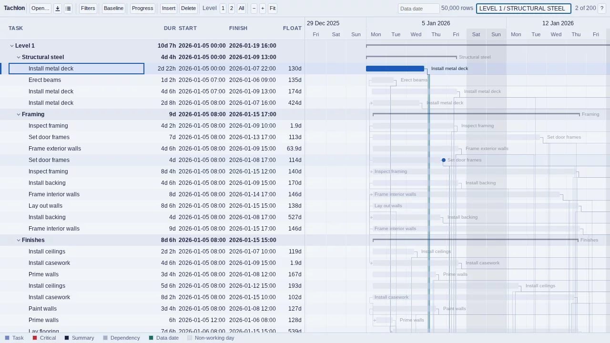

# Find your way around a big schedule
<!-- journey: J2 -->

{{#include ../../packages/gantt/guide/navigate.md:goal}}
Try it on the [50,000-task demo schedule](/?sample=demo-50k).

<figure class="shot">

<figcaption>Find a task by name: the box in the toolbar counts the matches, and Enter steps to the next one.</figcaption>
</figure>

## By hand

{{#include ../../packages/gantt/guide/navigate.md:moving}}

{{#include ../../packages/gantt/guide/navigate.md:filter-keys}}
On this page, the **Filters** button in the toolbar opens the Filters panel, which holds the filters and the Lookahead. Once a baseline is set (the toolbar's **Baseline** button keeps the dates as they are now), a **Slipped** button appears in the Filters panel and keeps only the tasks that finish later than the baseline, with their summaries; a task added since the baseline is not kept.

{{#include ../../packages/gantt/guide/navigate.md:filters}}
On this page, the Filters panel has an **Activity code** choice for such a file, and a **Clear** button appears in the panel while it is on and removes the activity-code restriction; a Lookahead window that is on, and any summaries you collapsed, stay as they are. The **Show moved** button is in the Filters panel from the start, disabled until an edit moves other tasks ([Change dates and see what moved](j7-change.md)). When filters are on, the Filters button shows how many, for example `Filters · 2` with a filter and the Lookahead on. The **Lookahead** toggle in the Filters panel, with its date box and weeks box, is the Lookahead.

{{#include ../../packages/gantt/guide/navigate.md:find}}
On this page, Ctrl+F (Cmd+F) goes to the find box in the toolbar.

{{#include ../../packages/gantt/guide/navigate.md:read}}

The toolbar shows the active filters and the visible row count, for example
`Critical only · 21 of 50,000 activities` (Critical only, Near critical and Longest path count
the activities they keep, not the rows, which also hold the summaries above them). The number after "of" counts
every activity in the schedule, summaries included: the [office fit-out sample](/?sample=office-fitout), with 50 activities
under 9 summaries, reads `Critical only · 23 of 59 activities`. With an activity code on, it names the code, for example
`Phase = Civil · 14 of 41 rows`. With only Slipped on, it counts the slipped tasks, for example
`46 slipped`, not the rows. With Longest path on, a line at the chart's bottom left names the path: its
first and last activity, how many activities it holds, and the calendar days from the first start to
the project finish, for example `Longest path: Excavate to Handover · 14 activities · 212 days`.

{{#include ../../packages/gantt/guide/navigate.md:copy}}

{{#include ../../packages/gantt/guide/navigate.md:export}}
On this page, open the hosted page's **Open…** menu and choose **Export the list as CSV**. **Copy the list** in the same menu does the same as `Ctrl+C`, and **Export the list as Excel** is under the CSV item.

## Where it is checked

`packages/gantt/tests/zoom-pan.spec.ts`, `outline.spec.ts`, `filters.spec.ts`, `lookahead.spec.ts`,
`find.spec.ts` and `selection.spec.ts` assert each of these through the `GanttHook` test hook;
`baseline.spec.ts` asserts the Slipped button, and `columns-menu.spec.ts` the Columns menu.
