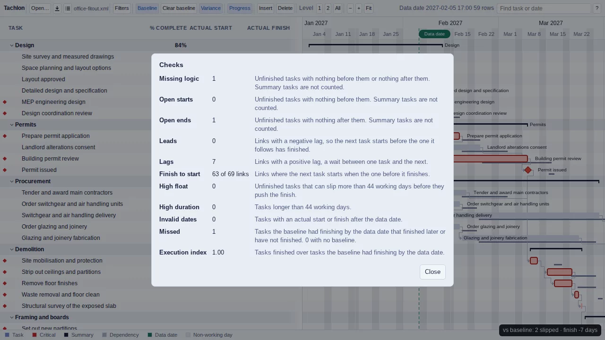

# Check a schedule
<!-- journey: J4 -->

**Goal:** before you trust a schedule's dates or send it on, count the things that make a schedule
unreliable: tasks tied to nothing, odd links, and tasks that are very long or very loose. The
Checks panel gives fourteen lines. It does not say pass or fail; you decide what a count means for
your schedule.

<figure class="shot">

<figcaption>The Checks window lists the counts and does not say pass or fail.</figcaption>
</figure>

## By hand

1. **Open the panel.** Click **Checks** in the toolbar, the button with three short lines, beside
   **Open…** and the export button. A window titled **Checks** opens over the chart with fourteen
   lines, each with the check's name, its number and one sentence on what it counts. A line with a problem to show adds a second sentence, in the text color, on why that kind of problem matters; a line that counts `0` adds none. Try it on the
   [office fit-out sample](/?sample=office-fitout).
2. **Read the lines.** On the fit-out sample, the lines from Missing logic to Missing resources read Missing logic `1`, Open starts `0`, Open ends `1`, Leads `0`, Lags `7`, Finish to
   start `63 of 69 links`, High float `0`, High duration `0`, Hard constraints `0`, Negative float `0`,
   Invalid dates `0` and Missing resources `0`.
3. **Close it.** **Close** or `Escape` shuts the window, and the chart gets its keys back.
4. **It counts again each time it opens.** The window shows the schedule as it was when you opened
   it. On the fit-out, click the bar of **Detailed design and specification**, press `]` to select
   one of its links, press `Delete`, and open **Checks**: Missing logic reads `2`, Open starts `1`, Open ends `1` and Finish to
   start reads `62 of 68 links`. Close it and press `Ctrl+Z`, and the panel reads `1`, `0`, `1` and `63 of
   69 links` again.
5. **Missing logic.** Unfinished tasks with nothing before them or nothing after them, summary
   tasks not counted. An unlinked task floats free of the schedule: if its predecessor slips,
   nothing moves it. **Open starts** counts the same tasks that have nothing before them, and
   **Open ends** those that have nothing after them, so you can see which side is loose; a task
   with no links at all is in both, and counts once in Missing logic. These three lines have a
   **Show** button while their count is above 0: it closes the window and keeps only the tasks that line counts, the same as the
   Check choice in **Filters** (the row count reads `Check = Open ends`). The High float, High duration, Hard constraints, Negative float, Invalid dates, Missing resources and Missed lines have one too, while their count is above 0 (Invalid dates keeps leaf tasks only). Hover bars for the card that
   shows each task's predecessor and successor counts (see [Find your way around a big
   schedule](j2-navigate.md)), then add the link as in [Build a schedule from the
   keyboard](j6-build.md).
6. **Leads and Lags.** Leads are links with a negative lag, so the next task starts before the one
   it follows has finished; Lags are links with a positive lag, a wait between the two. A lead
   makes the dates depend on an overlap nobody can see on the bar, and a lag hides a task inside a
   link. To remove one, select the link, press `Enter` and type the type alone, such as `FS`, or
   add a task for the wait. The box takes `FS-1d` and `FS+2d`; see step 5 of [Build a schedule
   from the keyboard](j6-build.md).
7. **Finish to start.** The share of links that finish one task and start the next, such as `63 of
   69 links`; a file with no links reads `no links`. A low share means many start-to-start and
   finish-to-finish links, which are harder to follow. Look at the links that are not finish to
   start and ask whether each one is needed.
8. **High float.** Unfinished tasks that can slip more than 44 working days before they push the
   finish, counted in days of the task's own calendar. A very loose task is often missing a
   successor: check what it feeds.
9. **High duration.** Tasks longer than 44 working days. A duration of `100d` may be a typing slip
   for `10d`; if it is real, split the task into steps that can be tracked.
10. **Hard constraints and Negative float.** Hard constraints counts the unfinished tasks a fixed
    date holds: a start no later than, a finish no later than, or a must start on or must finish
    on date. A task held to a date ignores what its predecessors do, so each one is a place the
    logic no longer drives the schedule. Negative float counts the unfinished tasks that cannot
    meet a late date: a date that holds a task is earlier than the date its predecessors allow, so
    its float is below `0` and the task is critical. Both skip summary tasks and read `0` on a
    file with no such date.
11. **Invalid dates.** Tasks with an actual start or finish after the data date. A schedule cannot
    hold work done in the future: either the data date is too early, so move it (see [Update
    progress against a data date](j8-progress.md)), or an actual was typed wrong. On the fit-out,
    typing `2027-01-04` in the data date box makes this `13`.
12. **No data date.** With no data date set, Invalid dates reads `needs a data date` and never
    `0`, because a `0` would look like a clean check that never ran. The
    [50,000-task demo](/?sample=demo-50k) has none, and its panel reads that line. Type a day in
    the **Data date** box and press `Enter`, and the line is a number.
13. **Missing resources.** Unfinished tasks with a duration and no resource, summary tasks and
    milestones not counted. A task nobody is assigned to carries no labor or cost. When the file
    lists no resource at all, the line reads `needs resources` and never `0`, for the same reason
    as the data date. A P6 XER file reads that way for now, because the XER reader does not read
    its assignments yet; the [50,000-task demo](/?sample=demo-50k) has none either. On the fit-out
    sample, every task but the milestones has a crew, so it reads `0`.
14. **Missed and Execution index.** Both read the baseline (see [Set a baseline, read what slipped](baseline.md))
    against the data date. Missed counts the tasks the baseline had finishing by the data date that
    finished later or have not finished yet; it reads `0` with no baseline. Execution index is the
    tasks finished over the tasks the baseline had finishing by the data date, such as `0.80`. When
    none were due, with no baseline or no data date, it reads `none due`, never `0`.
15. **How high is high.** The panel shows no limit. The limits in DCMA's 14-point assessment
    guidance are 5% of tasks for missing logic, high float, high duration, hard constraints and
    missed tasks, 5% of links for lags, at least 90% of links finish to start, zero allowed for
    leads, negative float and invalid dates, and an execution index of at least 0.95. They are
    guidance, not rules. Work out the share yourself from the count and the number of tasks or
    links, and treat a count a little over a limit as a prompt to look.
16. **What is not built.** The fourteen lines cover twelve of DCMA's fourteen checks. The other two
    are on [What's coming](coming.md).

## Where it is checked

`apps/hosted/tests/checks-dialog.spec.ts` presses the button on a file with a hand-counted answer
and reads each line's name, number and sentence, the reason a flagged line gives and a `0` line does not, the `needs a data date` and `needs resources` lines, a file with one
unassigned task, and `no links`.
`packages/gantt/tests/checks-report.spec.ts` asserts the counts the page asks the engine for.
`crates/app/tests/checks.rs`, `checks_schedule.rs` and `checks_report.rs` check the counts
against hand-solved schedules, and the report's JSON.
