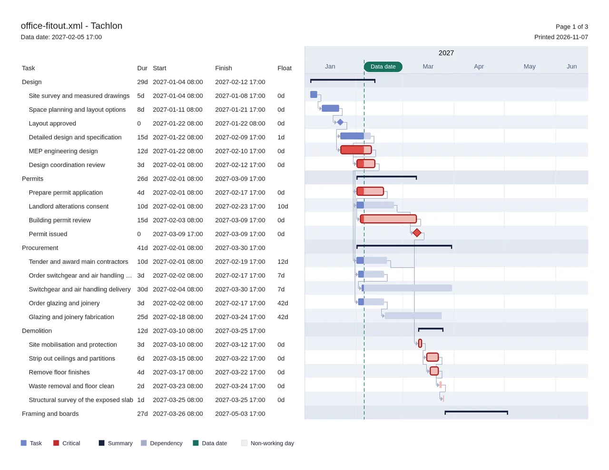

# Print a schedule
<!-- journey: J5 -->

{{#include ../../packages/gantt/guide/print.md:goal}}

<figure class="shot">

<figcaption>Page 1 of the printed office fit-out, as Save image (PNG) saves it: a long name stops inside its column. This still was taken when dates printed with their time; they now print as the day alone.</figcaption>
</figure>

## By hand

{{#include ../../packages/gantt/guide/print.md:print}}

   On this page, you can also click **Open…** in the toolbar and choose **Print...**. The menu closes and the browser's print dialog opens.

{{#include ../../packages/gantt/guide/print.md:pages}}

   To select a range of rows, see [Build a schedule from the keyboard](j6-build.md).

{{#include ../../packages/gantt/guide/print.md:paper}}

   On this page, click **Open…**, then **Print on A4...**; **Print...** in the same menu prints on US Letter.

{{#include ../../packages/gantt/guide/print.md:image}}

   On this page, click **Open…**, then **Save image (PNG)**. The picture of the office fit-out sample is `office-fitout.png`.

{{#include ../../packages/gantt/guide/print.md:layout}}

   On this page, click **Open…**, then **Save layout...**, and type a name. This browser keeps it: the layouts stay in this browser only, and another browser or another person's computer has none. To put one back on a schedule, click **Open…**, then **Apply layout...**, and type one of the names it lists.

9. **What is not built.** Choosing a date range, and picking printed columns apart from the
   screen's, are on [What's coming](coming.md).

## Where it is checked

- `packages/gantt/tests/print-pages.spec.ts` asserts that `beforeprint` puts one SVG per page on the
  sheet and `afterprint` removes them, that printing leaves the scroll and zoom as they were, and
  that a column hidden in the Columns menu is not on the page.
- `packages/gantt/tests/print-sheet.spec.ts` asserts the plain text sheet that prints when no page
  was filled.
- `packages/gantt/tests/journey-j5.spec.ts` prints a filtered schedule and checks that every page has
  a header and a legend and that the pages hold every shown row in order, then that `printOn("a4")`
  prints A4 pages and the next print is Letter.
- `apps/hosted/tests/print.spec.ts` asserts that print media shows only the pages and that the saved
  PDF is Letter landscape (792 by 612 points), and that **Print on A4...** closes the menu and
  prints A4 landscape pages (842 by 595 points) once, with Letter again after it.
- `apps/hosted/tests/print-menu.spec.ts` asserts that **Print...** closes the menu and calls
  `window.print` once.
- `apps/hosted/tests/export-image.spec.ts` asserts the picture's file name, PNG signature and size.
- `apps/hosted/tests/layouts.spec.ts` saves a layout from the File menu, reloads on another sample,
  applies it and checks the same columns in the same order.
- `crates/app/tests/print_columns.rs` checks that the columns a page prints are the ones it is told,
  in that order, that a hidden Float leaves the name column its width, that a date prints as a day,
  that the list text stays at 9 px or more and that the timeline names its months.
- `crates/app/tests/print_pages.rs`, `print_lookahead.rs` and `print_legend.rs` check the names on
  the pages against the visible rows, the page count, the header's data date, filter, Lookahead
  window and print date, the left-out line, a range and the legend; `print_pages.rs` also checks the
  A4 layout.
