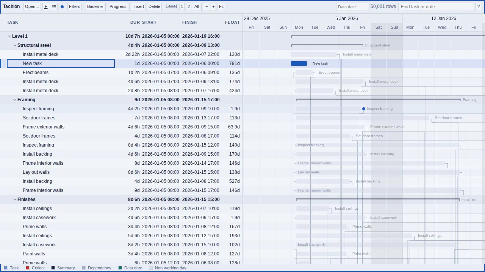

# Build a schedule from the keyboard
<!-- journey: J6 -->

**Goal:** add and change tasks and links without leaving the keyboard. To start from nothing, choose **New schedule**,
the first item of the Open menu: it gives a schedule with no tasks that starts on this week's Monday, and asks first
when the open schedule has unsaved changes. Until it has a task, the task list says "No tasks yet. Press Insert, or
Mod+Enter, to add the first one." The task list takes typed predecessors; this chapter covers them and the
other edits.

<figure class="shot">

<figcaption>Insert adds a one-day task below the selected row and selects it.</figcaption>
</figure>

## By hand

1. **Insert a row.** Press `Insert` or `Mod+Enter` (`Mod` is Ctrl or Cmd), or the toolbar's **Insert** button. A task named `New task` of
   1 working day appears as a sibling after the selected row's whole subtree, and is selected. After the keys the cell cursor is on its name: type a name and press Enter (the button does not move the cursor). In a file that
   shows an ID column, the new row gets the next activity ID: the
   prefix of the nearest row above that has an ID, at least that ID's digit width, and one above the largest number any row has with
   that prefix (`A1031` when the largest ID with prefix `A` is `A1030`; `A1-10` after `A1-2` when
   `A1-9` exists, because the number needs another digit).
2. **Edit a cell.** Double-click a task's name, duration, start or finish cell. Enter commits, Escape cancels. A
   duration is typed in working days (`3d`), hours (`4h`), minutes (`30m`) or a combination
   (`1d 4h`); a plain number is days (`5` is `5d`); `0` makes a milestone. A refused value shows the reason and changes nothing.
   In a Start cell, type a day written `YYYY-MM-DD`: it becomes the task's start-no-earlier-than, the edit a bar drag makes, as one undo step.
   In a Finish cell, type a day written `YYYY-MM-DD`: the start stays and the duration becomes the working time from it to the end of that day. A day before the start, or a summary row, is refused.
3. **Edit from the cell cursor.** Click a cell in the task list to select its row and put the cursor
   on that column; `Up` and `Down` move the selection one visible row and `Left` and `Right` move
   the cursor. On a name, duration, finish, Predecessors or, with the Progress columns showing, Actual start, Actual
   finish, Remaining or % complete cell, `Enter` or `F2` opens the editor with the
   old text (a Start cell has no cursor editor), a printable key opens it holding that key (type `5d` and press `Tab` to set 5 days),
   and `Backspace` opens it empty. `Enter` commits and moves down a row, `Escape` discards. `Tab` and `Shift+Tab`
   commit and move within one group of cells: Name and Dur, Finish and Predecessors (Finish alone in a file with no IDs), or the four progress cells (Actual start, Actual finish, Remaining, % complete). At the end of a group, `Tab` goes to the first cell of that group on the next row and `Shift+Tab` to the last cell of it on the previous row. While the cursor is in the list the chart's letter keys
   are suspended; `Escape`, a click on the timeline, focus leaving the chart, the end of the selection, or its row being hidden
   under a collapsed summary or by a filter takes the cursor out of the list.
   **Select a range of rows.** `Shift+Up` and `Shift+Down` move the far end of a range one visible
   row, `Shift`+click extends it to a row, and `Shift+Space` makes the selected row a range of
   its own. Collapsed children are skipped; a plain click or arrow, or `Escape`, ends the range.
4. **Add a link.** Hold `Alt` and drag from a leaf bar onto another bar, or drag from the dot
   beside the finish end of the hovered or selected bar. Releasing over a bar adds a
   finish-to-start link. The app refuses a link to a summary, a repeat of a link, and a loop (the
   message names the loop); a refusal shows in the alert line, the amber box in the toolbar. **Or type them.** In a file with an ID column, the task list also has a Predecessors
   column. Click a cell in it, type a list of activity IDs such as `3, 5SS+1d` (an ID, then an optional type and lag as in step 5) and
   press Enter: the task follows exactly those tasks, as one undo step. A mistake (an ID no task has, the task itself, a repeat)
   shows the reason and changes nothing. A summary, and a task that follows a task with no ID, has no editor.
5. **Change a link's type or lag.** Click an arrow, or click a task's bar to select it and press `]` or `[` to
   step through its links (after a click on a name cell in the task list, `]` opens the name editor holding "]" instead). With a link selected, press `Enter`: a small box beside the alert line
   shows the link's type and lag, such as `FS` or `SS+2d`, selected. Type a new one and press
   `Enter`. Write the type in either case, then an optional lag with its sign; a type alone means no lag:

   | Type | Meaning | With a lag |
   |---|---|---|
   | `FS` | finish to start | `FS-30m` |
   | `SS` | start to start | `SS+2d` |
   | `FF` | finish to finish | `FF-1d` |
   | `SF` | start to finish | `SF+1d 4h` |

   A day in the lag is a day of the calendar the lag is counted in. The schedule recalculates and the
   note of what moved appears, as for any other edit. Text the app refuses (for example `XX`, or a
   type that repeats another link between the same two tasks) shows the reason in the alert line,
   leaves the box open so you can fix it, and changes nothing. `Escape` closes the box without a
   change. With no link selected, `Enter` still goes to the cell cursor.
6. **Remove a link.** Click an arrow, or click a task's bar to select it and press `]` or `[` to step through
   its links, then `Delete` or `Mod+Backspace`.
7. **Delete a row.** With a task selected and no link selected, `Delete` or `Mod+Backspace`, or the
   toolbar's **Delete** button, removes the row (`Mod` is Ctrl or Cmd). A summary is refused until its sub-tasks are gone.
8. **Indent or outdent a row.** `Alt+Shift+Right` (`Option+Shift+Right` on a Mac) makes the selected row the last child of the row above it; `Alt+Shift+Left` moves it to just after its parent, and the siblings below it become its children. Undo hands them back. A refusal, such as indenting the first row, shows in the alert line.
9. **Move a row.** `Alt+Shift+Up` (`Option+Shift+Up` on a Mac) moves the selected row, with its sub-tasks, above the sibling before it; `Alt+Shift+Down` moves it below the sibling after it. No task's dates or links change, and the row stays selected. The first and last sibling, a row filter or lookahead window, and a bar drag in progress are refused in the alert line.
10. **Undo.** Ctrl+Z undoes any of these, Ctrl+Shift+Z or Ctrl+Y redoes (Cmd on macOS). History
   keeps 200 steps. Undo and redo select the row they changed and scroll it into view.

Every one of these is one undo step. The keys do nothing while a cell or the find box has focus.

## Where it is checked

`packages/gantt/tests/insert-delete.spec.ts`, `indent.spec.ts`, `table-edit.spec.ts`, `cursor.spec.ts`,
`range.spec.ts`, `cell-grid.spec.ts`, `links.spec.ts`, `link-escape.spec.ts`, `link-edit.spec.ts` and `predecessors-column.spec.ts`. The Rust side checks each edit against a full `compute()` of the whole
schedule (`crates/app/tests/duration_cone.rs`).
