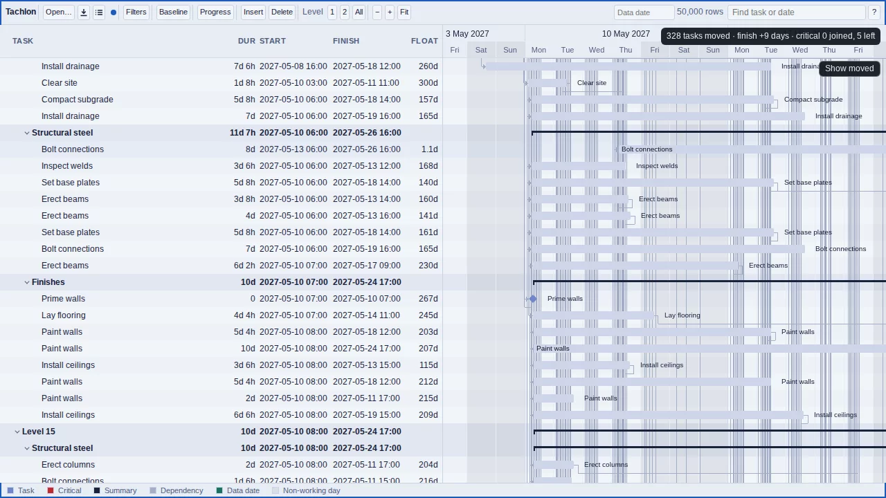

# Change dates and see what moved
<!-- journey: J7 -->

{{#include ../../packages/gantt/guide/change.md:goal}}

<figure class="shot">

<figcaption>After a drag, the note at the top right says what moved; Show moved keeps only those tasks.</figcaption>
</figure>

## By hand

{{#include ../../packages/gantt/guide/change.md:steps}}

On this page, with Show moved on, the toolbar's count reads `Moved · N of M rows`. Adding, removing and changing a link is in [Build a schedule from the keyboard](j6-build.md), and the row filters are in [Find your way around a big schedule](j2-navigate.md).

## Where it is checked

`packages/gantt/tests/hover-drag.spec.ts` runs the hover card, bar drag, undo and redo journey.
`packages/gantt/tests/moved-note.spec.ts` checks the note: its text, the 4 second hold, the fade, the hold while the pointer is over it, and where it sits.
`packages/gantt/tests/moved-note-reduced.spec.ts` checks it with "reduce motion" on (full at 3.9 seconds, gone at 4.05, no fade) and after a drag release (the bars do not slide).
`crates/app/tests/filter_moved.rs` checks the Show moved filter, `moved-note.spec.ts` its button, and `packages/gantt/tests/moved-count.spec.ts` the toolbar's count.
`crates/app/tests/duration_cone.rs` and `crates/engine/tests/cone.rs` compare the recompute from
a moved or changed task with a full `compute()`.
