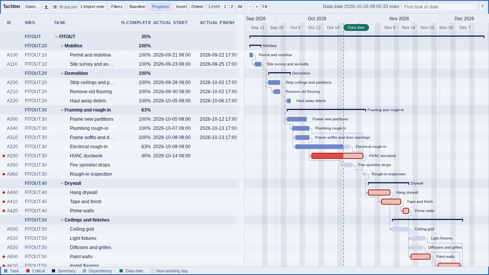

# Update progress against a data date
<!-- journey: J8 -->

**Goal:** record the progress of each task, move the data date forward, and see the schedule follow. The progress cells hold the actuals; the data date says where "now" is.

<figure class="shot">

<figcaption>A schedule with progress: the actuals sit in the task list and the data date is a line on the chart.</figcaption>
</figure>

## By hand

1. **Show the progress cells.** The **Progress** button in the toolbar adds four cells to the task
   list, right after Task, in this order: **% complete**, **Actual start**, **Actual finish**, **Remaining**. A file
   that carries actuals opens with them showing; on a file with none they start off, and the
   button turns them on, empty. Press it again to take them away. The button shows whether they
   are on.
2. **Type an actual.** Double-click a progress cell, or put the cell cursor on it and press
   `Enter`. Actual start and Actual finish take a day written `YYYY-MM-DD`; Remaining takes a
   duration such as `4h` or `2d`; % complete takes a whole number from 0 to 100, with or without
   the `%` sign, such as `75` or `75%`. `Enter` commits and `Escape` discards. `Tab` commits and
   walks Actual start, Actual finish, Remaining, % complete, so from Remaining it goes back to % complete, the cell nearest
   Task, and from % complete to Actual start on the next row; `Shift+Tab` walks the other way, to the previous row's % complete
   from Actual start. Each commit is one undo step (`Ctrl+Z`). Committing the text a cell already
   shows adds no undo step, and an actual start that has a time of day keeps it when you commit the same
   day.
3. **How the cells depend on each other.** Setting Remaining on a started task sets its %
   complete from the task's duration: a task of eight working hours with `4h` remaining reads
   `50%`. Setting % complete sets Remaining, so `75%` on that task reads `2h`. A % complete from 1 to 99 on a task with no actual start also gives it one, its early start (with a data date set, a % complete that would put that start after the data date is refused); from then it is started and fixed there (step 7). A `0` on a task with no actual start leaves it unstarted, with no actual start and no remaining. A % complete of
   `100` finishes the task: it gets an actual finish and `0` remaining, and one `Ctrl+Z` puts the
   three cells back as they were. Setting an Actual finish also sets Remaining to `0`.
4. **A refused entry.** A bad entry leaves the editor open with the reason under it, and changes
   nothing:

   | Entry | Message |
   |---|---|
   | An actual finish before the actual start | "The actual finish is before the actual start." |
   | Text that is not a day | "Write the date as YYYY-MM-DD." |
   | A % complete outside 0 to 100 | "Write the percent complete as a whole number from 0 to 100, such as 75 or 75%." |
   | An actual start or finish after the data date, or a % complete that would set one | "An actual date cannot be after the data date. Move the data date first, or write a date on or before it." |

   An actual the task already holds passes, so its remaining can still be edited.
   Typing clears the reason, and `Escape` leaves the task as it was. A summary row takes no
   progress entry, because its figures come from the tasks under it.
5. **Read a summary.** A summary row's % complete is the duration-weighted share of the leaves
   under it: with two leaves of eight hours and one of them finished, the summary reads `50%`. A
   summary with nothing started under it shows nothing.
6. **Move the data date.** The data date shows in the toolbar as `Data date YYYY-MM-DD HH:MM`
   and as a line on the chart. With no data date, an empty box labeled **Data date** sits there
   instead. To move it, click the date (or focus it and press `Enter` or `Space`) and type a day
   written `YYYY-MM-DD`, then press `Enter`. `ArrowUp` and `ArrowDown` step the box by a day and
   `Shift` with either steps a week; the date applies only when you press `Enter`, and `Escape`
   puts the shown date back. Text that is not a date is refused in the alert line ("Write the data
   date as YYYY-MM-DD."), and the box keeps focus and your text. An empty box plus `Enter` clears
   the data date. `Enter` on the date as it stands adds no undo step.
7. **What changes when it moves.** The line moves to 00:00 on the day. Work that has not started
   cannot start before the data date, so every such bar that sat before it moves right to the
   new date, and the tasks after it follow. Started and finished tasks are fixed at their actuals
   and do not move. The whole move is one undo step:
   `Ctrl+Z` puts the date, the line and every bar back, and `Ctrl+Shift+Z` repeats it. Clearing
   the data date lets the work it held back start earlier again. After a move that shifts other
   tasks, the note at the top right of the chart starts with `data date +7 days ·` (see [Change
   dates and see what moved](j7-change.md)).
8. **Go to the data date.** With the chart focused and the cell cursor not in the list, `t` pans
   the chart to the data date, keeping the zoom. With no data date it does nothing.
9. **Filter by status.** The **Status** choice in the Filters panel keeps only the tasks that are
   *In progress*, *Not started* or *Complete*; the **Status** entry at the top clears it. It is one filter at a
   time like the others in [Find your way around a big schedule](j2-navigate.md).

## Where it is checked

`packages/gantt/tests/progress-toggle.spec.ts` asserts the Progress button: the four cells appear empty on a
file with no actuals and go again, the chart works without the toolbar, and a summary reads the
duration-weighted % of its leaves.
`packages/gantt/tests/progress-edit.spec.ts` types into the cells with the mouse and keyboard: the actual
start and its undo, the unchanged commit, Remaining and Actual finish with one undo each, the
refusal messages, `Tab` and `Shift+Tab`, and `100` in % complete.
`packages/gantt/tests/percent-cell-scrolled.spec.ts` checks that a press on a cell with the table scrolled
right goes to that cell and never back to Name.
`packages/gantt/tests/data-date.spec.ts` asserts the data date box: a typed day moves the line and the
unstarted bars, a refused entry, the arrow keys, an empty box and the undo and redo of each.
`packages/gantt/tests/goto-data-date.spec.ts` asserts `t`, and `packages/gantt/tests/filter-status.spec.ts` the Status
choice.
`crates/app/tests/data_date_edit.rs` checks the data date move against hand-solved dates, and
`crates/app/tests/progress_edit.rs` and `progress_rollup.rs` the progress entries and the summary
figure.
