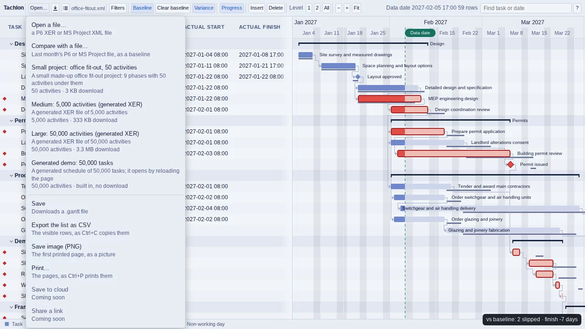

# Save, reopen and export a schedule
<!-- journey: J9 -->

{{#include ../../packages/gantt/guide/save.md:goal}}

<figure class="shot">

<figcaption>Save is in the Open… menu; the download button beside it exports a P6 or MS Project file.</figcaption>
</figure>

## By hand

{{#include ../../packages/gantt/guide/save.md:save}}

   On this page, you can also click **Open…** in the toolbar and choose **Save**. The office fit-out's `office-fitout.xml` saves as `office-fitout.gantt`.

{{#include ../../packages/gantt/guide/save.md:dot}}

{{#include ../../packages/gantt/guide/save.md:reopen}}

   On this page, to reopen, click **Open…** and choose **Open a file…**. The tab's title reads `office-fitout.gantt - Tachlon`.

{{#include ../../packages/gantt/guide/save.md:unsaved}}

{{#include ../../packages/gantt/guide/save.md:export}}

   On this page, on the office fit-out sample the P6 window lists `the baseline
   on 50 tasks was not written`, and the MS Project window lists the reader's own note, `not in the
   project, left out by the reader: 47 tasks have resource assignments; only the resource names were
   read, and no dates are affected.` On the sample, which has ten tasks under way, neither lists any of the actuals. Opening the exported `.xml` shows them:
   **Detailed design and specification**, which read `2027-01-22` as its start, comes back started,
   at `2027-01-22`. Opening the
   exported `.xer` shows 60 rows against the schedule's 59: the extra one is a summary row at the
   top, named `Project 1`, that holds all the phases.

{{#include ../../packages/gantt/guide/save.md:keep}}

9. **What is not built.** **Save to cloud** and **Share a link** are in the **Open…** menu, grayed out
   as `Coming soon`. They are on [What's coming](coming.md).

## Where it is checked

`packages/gantt/tests/save-open.spec.ts` asserts `Ctrl+S` downloads the document and **Open** reads
it back, `save-name.spec.ts` the file's name and that a save during a cell edit saves nothing,
`unsaved-mark.spec.ts` the dot, `save-note.spec.ts` the note, `save-failure.spec.ts` the message
for a failed save, `open-unsaved.spec.ts` the question before an open over edits, and
`open-document.spec.ts` that a file opens by its content.
`packages/gantt/tests/export.spec.ts` edits a row and exports it to both formats.
`apps/hosted/tests/save-menu.spec.ts` asserts the **Save** item, and `menu-coming-soon.spec.ts` the
two grayed-out items.
`crates/app/tests/document_round_trip.rs` checks save, open and save again, and `export_mspdi.rs`
and `export_xer.rs` the two exports; `crates/import/tests/mspdi_export.rs` and `xer_export*.rs`
read each written file back and compare it with the schedule.
