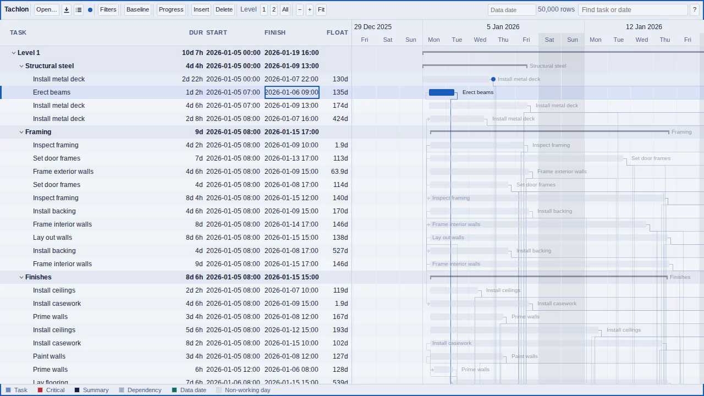

# Keys

Keys act only while focus is inside the chart (`docs/ARCHITECTURE.md`, Embedding, rule 2). The page starts with focus on the
chart, and a click anywhere in it takes focus back. The table below is the one in `docs/KEYS.md`,
included here so the two cannot drift.

<figure class="shot">

<figcaption>The arrow keys move the cell cursor: down a row, right a column.</figcaption>
</figure>

{{#include ../../docs/KEYS.md:keys}}
