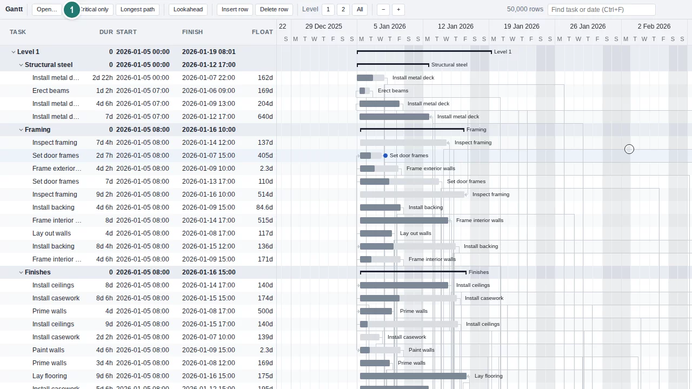
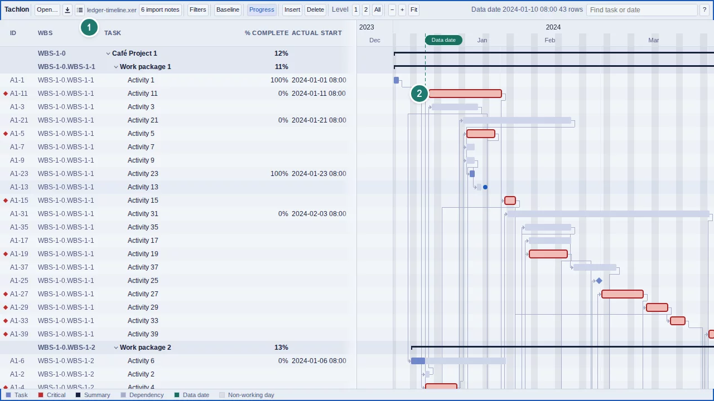
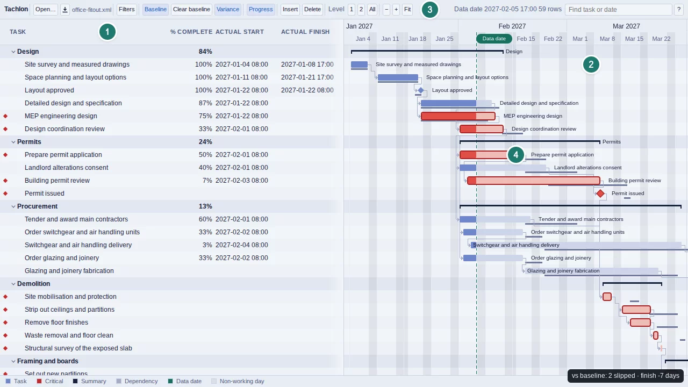

# Open a schedule

<!-- journey: J1 -->

Drop a P6 file (`.xer`), an MS Project file (`.xml`) or a Tachlon file (`.gantt`, the file <kbd>Ctrl</kbd>+<kbd>S</kbd> saves) on the chart, or click **Open…**. The whole
schedule is on the page at once: the task list on the left, the timeline on the right, the
critical path in red.

<video class="clip" controls muted playsinline preload="metadata" poster="media/open-a-schedule.webp">
  <source src="media/open-a-schedule.mp4" type="video/mp4">
</video>

## Get a file out of P6

In P6 Professional, export the project as an XER file:

1. Open the project. To put several projects in one file, open them all.
2. Choose **File** > **Export**.
3. Choose **Primavera PM - (XER)**, pick a version from the list, and click **Next**. Tachlon
   opens a file by its first line, `ERMHDR`, whatever its version. It has been tried on P6 19.12
   only: if a file does not open, report it with the version from that line.
4. Choose **Project** and click **Next**.
5. Tick **Export** beside each project you want in the file, type a file name and where to save
   it, and click **Finish**. Click **Close** when the export ends.

Links between projects that are in the same file are kept.

## Get a file out of MS Project

In the Microsoft Project desktop program, save the project as an XML file:

1. Open the project.
2. Choose **File** > **Save As**.
3. Choose where to save the file and type a name.
4. In the **Save as type** box, choose the XML format, then click **Save**. If you leave the type
   as it is, Project saves an `.mpp` file, which Tachlon cannot open.

## Steps

1. Click **Open…** in the toolbar. It opens a menu with **New schedule** and **Open a file…** first; choose **Open a file…**.
   Pressing <kbd>Ctrl</kbd>+<kbd>O</kbd> still opens the file chooser at once. You can also drop
   the file anywhere on the chart: a dashed outline and the words "Drop to open" show while the file is over it. A file dropped beside the chart is refused.
2. Choose your `.xer` file, your MS Project `.xml` file or your `.gantt` file.
3. If the file holds several projects, a list appears: pick one, or open all of them. Each
   entry shows the project id, its short name and its activity count. Press <kbd>Esc</kbd> or
   click **Cancel** to close the list; the schedule on the page stays as it was.
4. Read the schedule. The timeline is fitted to the project you opened. With **Open all**,
   each project opens as a top-level summary. Critical activities are red, with a red diamond in the task list. The data
   date is a line on the time axis.
5. The panel that lists what was not read is shut when a file opens. If the file had anything
   to report, the **N import notes** button appears in the toolbar; click it to open the panel.
   **Dismiss** shrinks the button to a small mark; a click on the mark lists the notes again.
   A note that counts activities names at most its first five, as in "600 (first: A1010, A1020,
   A1030, A1040, A1050)". Tachlon keeps no list of the rest, so the count is the only complete figure.

<figure class="shot">

<figcaption>1: the Open… button. The chart behind it is the <a href="/?sample=office-fitout">office fit-out sample</a>, the schedule the page opens with until you open a file or pick another sample.</figcaption>
</figure>

<figure class="shot">

<figcaption>1: the one line the toolbar shows about your file: its name. Point at it to read its format and its task count too. A long line is cut with …; the tooltip has the whole of it. 2: a critical activity, red on the chart and in the task list. The panel of what was not read is shut: step 5 says how to open it.</figcaption>
</figure>

<figure class="shot">

<figcaption>The office fit-out sample, open.</figcaption>
</figure>

1. **The task table.** One row per activity, indented under its summary. A red diamond marks a
   critical activity. Click a summary's chevron to fold it.
2. **The timeline.** Each activity is a bar on the time axis, with its links drawn between bars.
   Grey bands are non-working days. The dashed line is the data date.
3. **The toolbar.** **Open…**, the name of the file, **Filters**, the outline levels, zoom and
   **Fit**, and the search box.
4. **The critical path.** Critical bars are red. Press <kbd>Shift</kbd>+<kbd>C</kbd> to show only them.

<strong>Tip from Tachlon.</strong> Press <kbd>Shift</kbd>+<kbd>C</kbd> to show only the critical path, and again to go back to the view you had. A plain <kbd>c</kbd> jumps to the next critical activity.

## What the panel says about an MS Project file

The panel is headed with a count, for example "2 import notes: what was not read from this file". It
lists up to 500 lines. The list scrolls inside the panel, and the title row with the close button
stays in view. A file with more than 500 lines shows the first 500, then one last line such as
"and 21 more", and the title ends with ", first 500 shown". For an MS Project file the panel can
name two kinds of link it did not keep, and one kind of task whose dates may differ from
MS Project's. The chart still opens, and the other links in the file are kept.

- **A link to a task outside the file.** A project that is linked to another project holds links
  whose other end is not in the file. Such a link is dropped, and the panel names the task it
  belonged to and the missing end, for example "Task 12: a link from task 40 was dropped because that task is not in the file; …".
- **A link that touches a summary task.** The chart rolls a summary task up from its children and
  does not take a link on the summary itself. Such a link is dropped, and the panel names it once,
  for example "dependency 3 -> 7 (FS) dropped: task 3 is a summary task".
- **A started task whose dates differ from the engine's.** Tachlon applies an MS Project task's
  actuals when the file opens. For a task that has an actual start and no actual finish, the panel
  compares the `Start` and `Finish` in the file with the dates Tachlon computed. If any such task
  falls on a different calendar day, one line says so and names up to five of them by their task
  ID in the file, for example "in-progress activities: 2 of 5 show different dates in the file
  than the engine computed (first: 4, 9)". A data date that comes with a file does apply when the
  file opens. A file with no started tasks, or whose started tasks fall on the same days, has no
  such line. A task whose actuals Tachlon cannot use has its own line, for example "Task 4: the actual finish was not read because the task has no actual start; …".

A P6 XER file works the same way: its actuals are applied when it opens. An activity with an
actual start keeps it and finishes its remaining duration after the data date, and a finished
activity sits at its actual start and finish. The in-progress line above (the same wording)
counts only the activities whose dates in the file still differ from the ones Tachlon computed. A
started or finished activity is fixed at its actuals, so dragging its bar does not move it.

Some things the panel no longer lists, because the importer now applies them:

- **Elapsed durations and lags.** A task whose duration is in elapsed units counts every day of
  the week: 7 elapsed days run seven calendar days, weekends included, where 7 working days skip
  the weekend. A link with an elapsed lag counts that lag in calendar days too. A lag in
  percent is still set to zero and still listed, for example "Task 4: a link lag given as a percent was not read; …".
- **Work weeks and recurring exceptions.** A calendar's work week (for example one that works
  Saturdays) and a recurring holiday or working day (every N days, every N weeks on the days
  named, a day of each month, a day of each year) now move the task dates. A recurrence on a
  weekday of a month, such as the second Friday, is still listed ("Calendar 3: a recurring exception was not read; …") and does not move any date. A derived calendar's work week keeps
  the holidays of the calendar it derives from: a company holiday inside the work week's dates
  stays a day off, so a task no longer finishes early because the holiday counted as a working
  day. An exception on the derived calendar itself still wins on its own date.

The tests for elapsed units and for the recurrence codes build the file elements from the rules of
the MS Project format. No file written by MS Project itself is among them, so a real file may
still show a difference the tests do not.

Summary tasks themselves are not listed: they are drawn from their children's dates. A file whose only
finding would have been its summary tasks opens with no panel.

## Good to know

- The app is built for schedules of 50,000 activities. The aim is to open one in under two
  seconds. On one machine, a MacBook Pro M3 Pro, a generated 50,000-activity P6 file opened in
  171.5 ms and a generated MS Project file in 171.0 ms at the 95th percentile
  (`docs/MEASURING.md`, "Open time"). No other machine has been measured.
- A file that cannot be opened (cut short, neither format, empty, or over 256 MiB) shows the
  reason on a red line under the toolbar. The schedule already on the page stays as it was.
- The importer keeps tasks, the outline, durations, milestones, links with lag, calendars and
  holidays. XER and MS Project actuals are applied, and a P6 activity keeps both of its date rules,
  the main one and the second one. An MS Project task keeps its constraint, from as late as possible to
  finish no later than. The panel lists what it left out: a constraint with no date, working exceptions
  with no working times, and unknown code values.
- Keys work while the chart has focus. The page starts with focus on the chart, and a click
  anywhere in it takes focus back.
